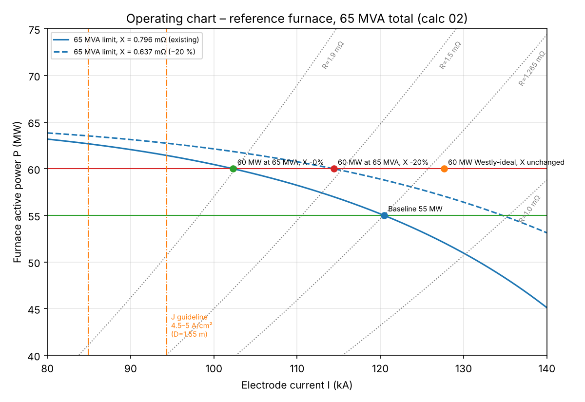

# 02 – Electrical Design: 55 MW Baseline and 60 MW Operating Window (Rev A)

**Status:** DRAFT – HOLD POINT 2 (Project Leader review)
**Basis:** `docs/01_Engineering_Design_Basis.md` Rev C, with the default answers to Q3, Q4, Q7 and Q8 accepted by the Project Leader on 2026-11-11.
**Verification:** every number below is reproduced by `calcs/02_electrical_operating_points.py`, with inputs in `calcs/parameters.py`. Outputs are `results/02_operating_points.csv` and `results/02_operating_chart.png`.

> **Data integrity:** the scenario is hypothetical and no plant data was supplied (S-10). The baseline is a **reference furnace** calibrated on published values for ferrochrome furnaces. Those values were taken from search excerpts because the full texts could not be retrieved from this session (network policy). They are flagged **AB** in `references/REFERENCES.md` and must be checked against the full text before the final report.

---

## 1. Electrical model

Balanced three-phase equivalent star circuit, one phase per electrode:

| Quantity | Equation | Unit |
|---|---|---|
| Active power | *P* = 3 *I*² *R* | W |
| Reactive power | *Q* = 3 *I*² *X* | var |
| Apparent power | *S* = 3 *I*² *Z* = 3 *V*_ph *I*, with *Z* = √(*R*² + *X*²) | VA |
| Power factor | PF = *R* / *Z* = cos φ | – |
| Line (secondary) voltage | *V*_LL = √3 *V*_ph | V |
| Electrode current density | *J* = *I* / (π *D*²/4) | A/cm² |
| Westly similarity [R-01, R-12] | *I* = *C₃* *P*^(2/3) (*I* in kA, *P* in MW, total furnace power) | – |

*R* is the furnace operating resistance per phase (bath + burden + electrode). *X* is the total circuit reactance per phase referred to the secondary (transformer + short network + electrode columns).

**Limitations, stated openly:** (i) the star equivalent ignores the electrical interaction between electrodes and phase unbalance [R-02]; (ii) circuit (busbar) resistance is lumped into *R*, so the electrical efficiency η_el is handled as a sensitivity (A-06); (iii) Westly's relation is used only to **calibrate the baseline current**, and its validity is disputed [R-03].

---

## 2. Calibrating the baseline current (Westly C₃)

No baseline current was given. It is anchored on a published ferrochrome furnace with the **same electrode diameter** as the 63 MVA South African ferrochrome analogue (A-16):

Analogue [R-13]: *P* = 48 MW, *I* = 110 kA, *D* = 1.55 m.

*C₃* = *I* / *P*^(2/3) = 110 / 48^(2/3) = 110 / 13.21 = **8.33**

This lies inside the range of 6–11 reported for high-carbon ferrochrome [R-12], which supports the calibration.

Current density of the analogue: *J* = 110 000 A / (π × 155² / 4 cm²) = 110 000 / 18 869 = **5.83 A/cm²**

> **Challenge to assumption A-07:** the published furnace runs at 5.83 A/cm², above the patent guideline of 4.5–5 A/cm² for *D* > 1.3 m [R-08]. That guideline is therefore **not** treated as a hard limit. The design criterion becomes: **the 60 MW case must not exceed the current density the existing furnace already operates at.** That level is proven in service for this furnace (by A-14/A-16), which is a more defensible criterion than a single patent.

---

## 3. The 55 MW baseline (reference furnace)

Assumptions: A-11 (power into the furnace) and A-14 (the existing 55 MW furnace already runs at the full 65 MVA).

| Step | Equation and substitution | Result |
|---|---|---|
| Current | *I* = 8.33 × 55^(2/3) = 8.33 × 14.46 | **120.5 kA** |
| Resistance | *R* = 55×10⁶ / (3 × (120.5×10³)²) = 55×10⁶ / 4.356×10¹⁰ | **1.264 mΩ** |
| Impedance | *Z* = 65×10⁶ / 4.356×10¹⁰ | **1.494 mΩ** |
| Reactance | *X* = √(1.494² − 1.264²) | **0.796 mΩ** |
| Power factor | PF = 1.264 / 1.494 | **0.846** |
| Reactive power | *Q* = √(65² − 55²) | **34.6 Mvar** |
| Secondary voltage | *V*_LL = √3 × 65×10⁶ / (3 × 120.5×10³) | **312 V** |
| Current density | *J* = 120 500 / 18 869 | **6.38 A/cm²** |
| *R*/*X* | 1.264 / 0.796 | **1.59** |

**Significance:** these values are consistent with the literature. A PF of 0.85 is typical for ferrochrome furnaces [R-02, R-14], and a few hundred volts at around 100–130 kA is consistent with the analogue furnaces. The baseline therefore describes a **typical modern closed ferrochrome furnace running at its transformer limit**. That is exactly why 60 MW is not available "for free".

---

## 4. The 60 MW cases

### 4.1 Cases that fail

| Case | *I* (kA) | *R* (mΩ) | PF | *S* (MVA) | *V*_LL (V) | *J* (A/cm²) | Verdict |
|---|---|---|---|---|---|---|---|
| 3a Westly-ideal current, existing *X* | 127.6 | 1.228 | 0.839 | **71.5** | 323 | 6.76 | ✗ exceeds 65 MVA by 10 % and exceeds baseline *J* |
| 3b Same resistance (just "turn up the current"), existing *X* | 125.8 | 1.264 | 0.846 | **70.9** | 325 | 6.67 | ✗ exceeds 65 MVA by 9 % and exceeds baseline *J* |

**Significance:** simply pushing more current, or following Westly's "ideal" scaling, overloads the 65 MVA transformers **and** the electrodes. The uprate has to come from a different electrical operating regime.

### 4.2 Required operating point at the 65 MVA limit

At *S* = 65 MVA and *P* = 60 MW: PF = 60/65 = **0.923**, so *R*/*X* = 0.923 / √(1 − 0.923²) = **2.40**.

Increase in *R*/*X* relative to the baseline = 2.40 / 1.59 − 1 = **+51.2 %**.
This percentage is **independent of the assumed *C₃***, because it depends only on the two power factors (calc 02, section 4). It is therefore the most robust result of this phase.

The +51 % can be split between **raising *R*** (electrode geometry and burden) and **lowering *X*** (short network):

| Case | *X* reduction | *X* (mΩ) | *R* needed (mΩ) | Δ*R* vs baseline | *I* (kA) | *V*_LL (V) | *J* (A/cm²) | Westly *C₃* |
|---|---|---|---|---|---|---|---|---|
| 3c-0 | 0 % | 0.796 | 1.910 | +51 % | 102.3 | 367 | 5.42 | 6.68 |
| 3c-10 | 10 % | 0.716 | 1.719 | +36 % | 107.9 | 348 | 5.72 | 7.04 |
| **3c-20 (proposed)** | **20 %** | **0.637** | **1.528** | **+21 %** | **114.4** | **328** | **6.06** | **7.46** |
| 3c-30 | 30 % | 0.557 | 1.337 | +6 % | 122.3 | 307 | 6.48 | 7.98 |

Worked substitution for the proposed case 3c-20:
*X* = 0.8 × 0.796 = 0.637 mΩ; *R* = 2.40 × 0.637 = 1.528 mΩ;
*I* = √(60×10⁶ / (3 × 1.528×10⁻³)) = √(1.309×10¹⁰) = 114.4 kA;
*V*_LL = √3 × 65×10⁶ / (3 × 114.4×10³) = 328 V;
*J* = 114 400 / 18 869 = 6.06 A/cm² (5 % **below** the baseline 6.38 A/cm²).

### 4.3 Engineering interpretation

1. **The 60 MW case is a higher-voltage, lower-current, higher-resistance operation.** In every feasible case the current is *lower* than the baseline 120.5 kA (except the 30 % reactance-reduction case), while the secondary voltage rises from 312 V to 328–367 V.
2. **The electrode diameter does not need to increase.** Because the current falls, the current density falls (5.4–6.1 A/cm² against 6.38 A/cm² today). This is a key outcome for "optimised electrode geometry": the optimisation is about the **pitch circle diameter (PCD) and the electrode tip position (which set *R*)**, not the diameter. Keeping *D* = 1.55 m avoids new electrode holders, contact clamps and casings.
3. **The required Westly *C₃* drops from 8.33 to 6.7–7.5.** That is still inside the reported ferrochrome range of 6–11 [R-12], at the low end that the literature associates with "a particular group of furnaces". The new operating point is therefore **unusual but not unprecedented**. This needs to be verified against the full text of R-12.
4. **Raising *R* alone (+51 %) is the high-risk route.** Higher resistance is usually obtained by raising the electrode tips (shallower penetration). That moves heat upward: hotter burden top, roof and off-gas, a colder hearth, slower tapping, and possibly more Cr₂O₃ lost to the slag. **A combination is therefore proposed** (case 3c-20): about 20 % lower total reactance plus about 21 % higher operating resistance.
5. **Is a 20 % reduction in total *X* credible?** About 70 % of a submerged arc furnace's reactance comes from the short network [R-14]. A 20 % total reduction therefore means about 29 % less short-network reactance (0.20 / 0.70). That requires real re-engineering: interleaved or bifilar busbars, a shorter distance from transformer to electrodes, and closing the delta at the electrodes. It is plausible but must be **demonstrated in Phase 4** with conductor geometry. Until then it is assumption **A-17** (low confidence).
6. **Electrical efficiency matters.** If 60 MW must arrive in the bath and the secondary circuit loses 2–6 %, the PF must rise to 0.94–0.98 (calc 02, section 4). At η_el = 0.96 that is practically impossible. This is why A-11 (power counted at the furnace terminals) is used, and why the circuit losses must be quantified in Phase 4.

### 4.4 Operating chart

The baseline sits on the 65 MVA limit curve (solid line). With the existing reactance, the 60 MW line can only be reached at about 102 kA and *R* ≈ 1.9 mΩ (green point). Reducing *X* by 20 % lifts the limit curve (dashed line), and 60 MW is reached at 114 kA and *R* ≈ 1.53 mΩ (red point). The Westly-ideal point (orange) lies outside both limits.

---

## 5. Sensitivity to the baseline calibration (*C₃* from 6 to 11)

| *C₃* | *I*_base (kA) | *R*_base (mΩ) | *X* (mΩ) | *R* required at 60 MW, existing *X* (mΩ) | Δ*R* | *V*_LL base (V) |
|---|---|---|---|---|---|---|
| 6.00 | 86.8 | 2.435 | 1.533 | 3.680 | +51 % | 432 |
| 7.00 | 101.2 | 1.789 | 1.127 | 2.704 | +51 % | 371 |
| **8.33** | **120.5** | **1.264** | **0.796** | **1.910** | **+51 %** | **312** |
| 9.00 | 130.2 | 1.082 | 0.682 | 1.636 | +51 % | 288 |
| 11.00 | 159.1 | 0.724 | 0.456 | 1.095 | +51 % | 236 |

**Interpretation:** the absolute currents and voltages depend on the calibration, but the **relative changes do not**. The conclusions in Section 4.3 therefore hold for any furnace in the reported ferrochrome range. *C₃* = 6 or 11 would give a current density of 4.6 or 8.4 A/cm² on 1.55 m electrodes. The latter is implausible, which supports a mid-range calibration.

---

## 6. Transformer requirements (preliminary; full specification in Phase 4)

| Item | Requirement | Basis |
|---|---|---|
| Rating | 65 MVA total, preferably 3 × 21.7 MVA single-phase units | S-07; single-phase units suit the triangular electrode layout and closing the delta at the electrodes |
| Secondary voltage range | Must cover 312 V (baseline) to 367 V (60 MW with no *X* reduction), plus about ±10 % control margin, **≈ 280–400 V** | Section 4.2 |
| Current rating | Electrode current up to the existing 120.5 kA plus margin (**≈ 125 kA**). With the delta closed at the electrodes, the winding current is *I*/√3 ≈ 72 kA | Baseline current, and to keep the ability to run 55 MW at a low resistance |
| Rated region | Constant MVA (65) above ≈ 310 V; constant current (≈ 125 kA) below | Standard furnace transformer practice (to be referenced, IEEE C57.17) |
| On-load tap changer | Steps of roughly 5–8 V (to be optimised in Phase 4) for fine power and resistance control | Engineering judgement |
| Short-circuit reactance | As low as practicable. The transformer's share of *X* counts toward the 20 % reduction target | A-17 |

**Significance:** if the existing transformers' tap range tops out near the baseline voltage (unknown, S-10), **the uprate needs a new tap range or new transformers even though the MVA stays 65**. This is the real reason the brief specifies the "65 MVA transformers" alongside the uprate.

---

## 7. New and updated assumptions (added to the register in docs/01)

| ID | Assumption | Value | Basis | Conf. |
|---|---|---|---|---|
| A-07 (revised) | Current-density criterion | *J*(60 MW) ≤ *J*(baseline) = 6.38 A/cm² | Published ferrochrome furnace at 5.83 A/cm² [R-13] exceeds the patent guideline [R-08]; the existing furnace's own J is the proven limit | M |
| A-15 | Grid frequency | 50 Hz | South African grid | H |
| A-16 | Baseline electrode diameter | 1.55 m Söderberg | Same as the 63 MVA SA ferrochrome analogues [R-11] and the 48 MW model furnace [R-13] | M |
| A-17 | Achievable total reactance reduction | 20 % (≈ 29 % in the short network) | 70 % of SAF reactance is in the short network [R-14]; feasibility to be shown in Phase 4 | **L** |
| A-18 | Westly *C₃* calibration | 8.33 | Analogue furnace [R-13]; within reported range [R-12] | M |

---

## 8. Open items carried to Phase 4

1. Translate the required +21 % in *R* into geometry: PCD, tip position, burden/reductant resistivity. This needs the Westly / Andreae–Kelly full texts (blocked, R-01).
2. Demonstrate the 20 % *X* reduction with short-network conductor geometry, and quantify the circuit losses (η_el).
3. Check the existing roof penetrations and electrode-to-wall clearance for any PCD change (S-08).
4. Harmonics, flicker and the HV-side power factor (capacitors improve the grid PF, **not** the transformer loading).

## 9. Decisions requested at HP-2

| Q | Question |
|---|---|
| Q9 | Accept the proposed operating point **3c-20** (60 MW, 114 kA, 328 V, *R* = 1.53 mΩ, *X* −20 %) as the design case, or prefer an option that changes only the resistance (3c-0) or only the reactance (3c-30)? |
| Q10 | Accept the revised current-density criterion (no higher than the existing furnace) in place of the patent guideline? |
| Q11 | Proceed to Phase 3 (metallurgical mass and energy balance) next, or Phase 4 (geometry and short network) first? |
