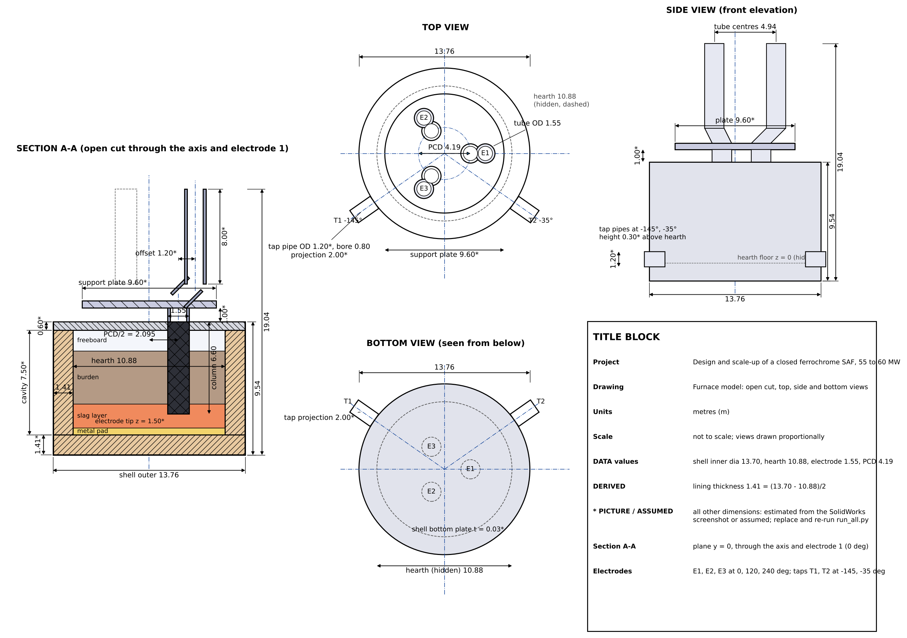
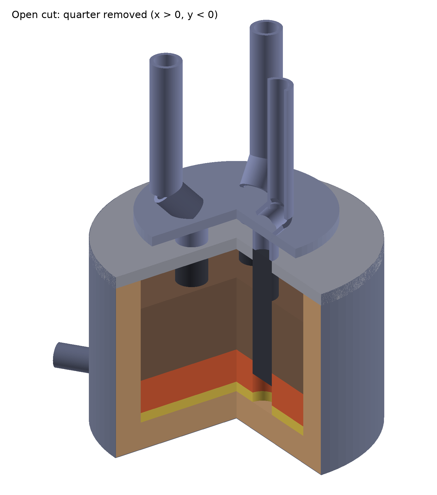
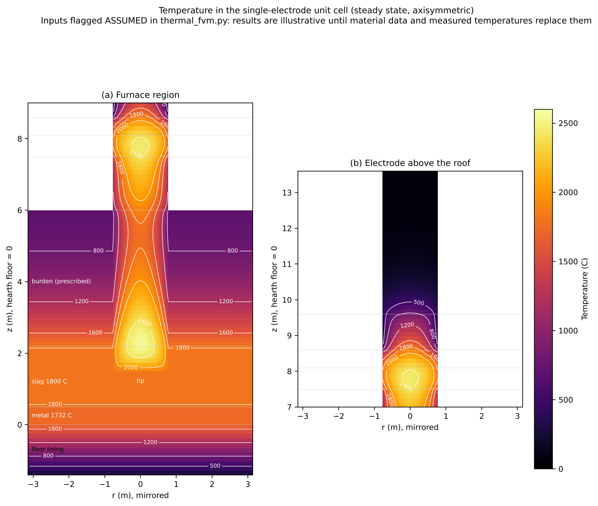
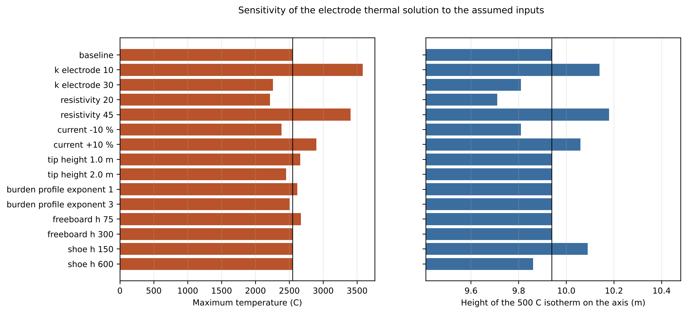

::: {custom-style="Appendix Heading"}
A.1 Purpose and files
:::

This appendix documents the furnace geometry that was built as a CAD model and the finite-volume temperature study of one electrode, which is the type of study that is set up in COMSOL Multiphysics (COMSOL AB, n.d.). The geometry was modelled parametrically in CadQuery (CadQuery contributors, n.d.), and every file is reproduced by running `run_all.py` in the folder `furnace_cad`. The files are in neutral formats that open in SolidWorks and that can be imported into COMSOL. No COMSOL project file (.mph) was produced, because COMSOL was not available; Table A.2 lists the set-up for it.

::: {custom-style="Table Caption"}
Table A.1: CAD and thermal files
:::

| File | Content |
|---|---|
| `params.py`, `furnace_parameters.json` | All dimensions, each tagged DATA, DERIVED, PICTURE or ASSUMED |
| `furnace_assembly.step` | Assembly with named bodies: steel shell, lining, roof, metal pad, slag layer, burden, three electrodes, two tap pipes |
| `furnace_solid.step`, `furnace_open_cut_quarter.step` (and `.stl`) | One solid, and a quarter open cut |
| `revolve_cut_profile_half_section.dxf` | Half-section sketch for the revolve and the revolve cut of the hearth cavity |
| `view_*.png/.pdf/.svg`, `furnace_drawing_sheet.png/.pdf` | Open cut, top, side and bottom views with dimensions |
| `thermal_fvm.py`, `thermal_run.py`, `thermal_results/` | Axisymmetric finite-volume solver, results and figures |
| `octave_check.m` | Independent MATLAB/Octave solution of the same problem |

::: {custom-style="Appendix Heading"}
A.2 Geometry and dimensions
:::

The screenshot of the SolidWorks model has no dimensions. Four values come from the project data and the design basis: the shell inner diameter of 13.70 m, the hearth diameter of 10.88 m, the electrode diameter of 1.55 m and the pitch circle diameter of 4.19 m. The lining thickness of 1.41 m follows from the first two. All other dimensions were scaled from the proportions of the picture or assumed, and are marked with an asterisk on the drawings. In the picture the tubes are thicker and further apart than the project data allow, so the model follows the data for the electrodes and the pitch circle, and the picture for everything else. The picture values are replaced by editing `params.py`.

The hearth cavity is a true revolve cut: a cylinder of lining is cut by the revolved half-profile (radius 0 to 5.44 m, height 0 to 7.50 m). The CAD volume of the lining, 616.15 m³, equals the analytic revolve volume.

{width=6.3in}

::: {custom-style="Figure Caption"}
Figure A.1: Drawing sheet with the open cut (section A-A), top, side and bottom views. Dimensions are in metres; an asterisk marks a value estimated from the picture or assumed.
:::

{width=4.4in}

::: {custom-style="Figure Caption"}
Figure A.2: Open cut with a quarter removed, showing the lining, metal pad, slag layer, burden and electrode column.
:::

::: {custom-style="Appendix Heading"}
A.3 Thermal model of the electrode
:::

The model solves steady heat conduction with a volumetric source, div(k grad T) + q = 0, for one electrode and the equal-area slice of the furnace around it (radius 10.88 / (2 √3) = 3.14 m), from the bottom of the floor lining to 4 m above the electrode support plate. It is axisymmetric and uses the finite-volume method (Patankar, 1980).

The Joule source in the electrode is calculated for the 50 Hz current including the skin effect. The current density follows J(r) proportional to I₀(kr), with k = (1 + j)/δ and δ = √(2ρ/(ωμ₀)) = 0.48 m (Smythe, 1968). The total current is the 130.1 kA estimated for design C1 in Chapter 10, which is an estimate and not a measurement. The slag layer is fixed at 1 800 °C, the in-furnace slag temperature in the plant data, and the metal pad at 1 732 °C, the alloy liquidus plus the mean superheat. The burden temperature is prescribed from the process, falling from the slag temperature at the bath to the gas temperature at the stock line, because the gas-solid heat exchange and the reactions of the charge are outside a conduction model. Free surfaces use a film coefficient to the local environment, the contact shoes are water cooled, and the cell edge is adiabatic.

::: {custom-style="Table Caption"}
Table A.2: Inputs of the thermal model and the set-up for COMSOL
:::

| Input | Value | Tag | COMSOL feature |
|---|---|---|---|
| Slag temperature | 1 800 °C | DATA | Temperature, slag domain |
| Metal temperature | 1 732 °C | DERIVED | Temperature, metal domain |
| Electrode current | 130.1 kA | DERIVED (estimate) | Heat source, 50 Hz, with skin effect |
| Electrode resistivity | 30 µΩ·m | ASSUMED | Material, electrode |
| Electrode conductivity | 20 W/(m·K) | ASSUMED | Material, electrode |
| Lining conductivity | 3 W/(m·K) | ASSUMED | Material, lining |
| Film coefficient: freeboard, roof, shoes, above shoes | 150, 30, 300, 15 W/(m²·K) | ASSUMED | Heat flux, convective |
| Gas, roof and air temperatures | 700, 60, 40 °C | ASSUMED | External temperature |
| Contact shoes | top at z = 9.6 m, band 1.0 m | ASSUMED | Boundary selection |
| Study | Stationary | n/a | Heat transfer in solids |

::: {custom-style="Appendix Heading"}
A.4 Results
:::

{width=6.2in}

::: {custom-style="Figure Caption"}
Figure A.3: Temperature in the single-electrode unit cell (steady state). Inputs marked ASSUMED make the temperatures inside the electrode illustrative.
:::

::: {custom-style="Table Caption"}
Table A.3: Results of the thermal model
:::

| Quantity | Value |
|---|---|
| Joule heat in one electrode | 2.74 MW |
| Net heat from the electrode to the slag, metal and burden | 1.46 MW |
| Heat lost from the electrode surface (freeboard, roof, shoes) | 1.18 MW |
| Heat lost through the floor of the cell | 0.10 MW |
| Highest temperature, inside the electrode | 2 550 °C (2 220 to 3 580 °C over the cases tested) |
| Electrode surface at the stock line | about 770 °C |
| 500 °C isotherm on the axis (baking zone) | z = 9.94 m, 0.34 m above the contact shoes |

{width=6.0in}

::: {custom-style="Figure Caption"}
Figure A.4: Sensitivity of the maximum temperature and of the baking-zone height to the assumed inputs.
:::

The temperatures of the slag, the metal and the floor lining follow from plant data. The temperature inside the electrode does not: it is set by the assumed resistivity, conductivity and cooling, and changes by more than 1 000 °C over the cases tested. The position of the baking zone changes by only about 0.5 m. The study therefore ranks the effect of each input and locates the baking zone relative to the contact shoes, but it becomes a prediction only when electrode material data and one measured temperature are available.

::: {custom-style="Appendix Heading"}
A.5 Validation and limits
:::

The solver was checked against the analytic solution for a long cylinder with a uniform source and a fixed surface temperature, T(0) = Ts + qR²/(4k) (Carslaw and Jaeger, 1959): 1 101.0417 °C against 1 101.0417 °C, a relative error of 3.5 × 10⁻⁸. The maximum temperature changed by less than 0.1 °C when the mesh was refined from 1 440 to 22 992 cells, the energy balance of the cell closes to 1.5 × 10⁻⁸ W on 2.7 MW, and an independent MATLAB/Octave assembly of the same arrays agrees to 1.5 × 10⁻¹¹ °C (GNU Octave, n.d.).

The model is a single-electrode axisymmetric cell, so the interaction between the three electrodes, the current paths in the bath and the arc are outside it. The burden temperature is prescribed and the study is steady state. The next steps are a three-dimensional COMSOL study of the STEP assembly, the replacement of the picture dimensions by the SolidWorks values, and calibration against one measured temperature.
