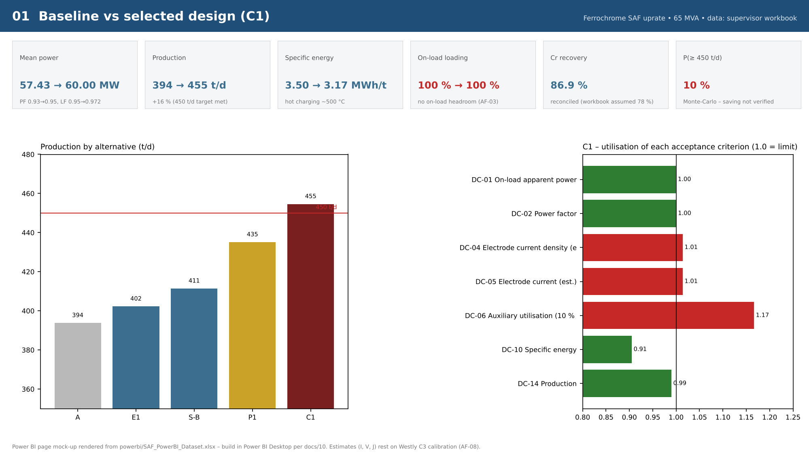
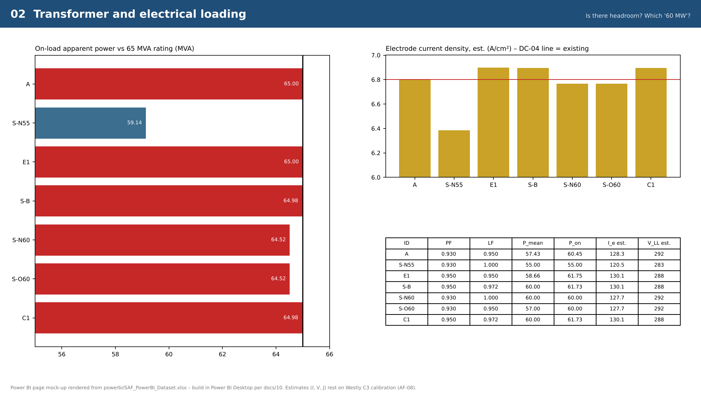
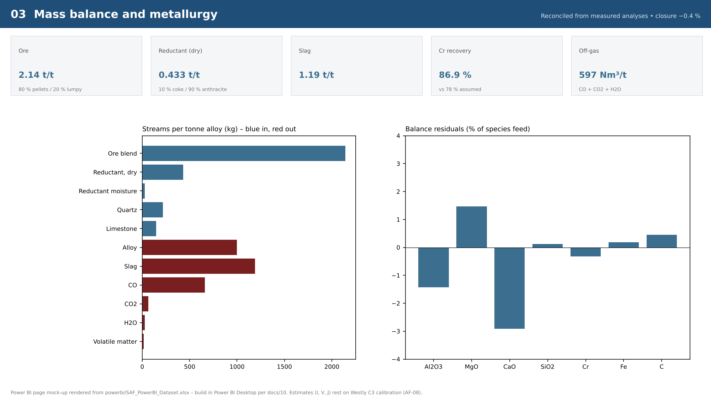
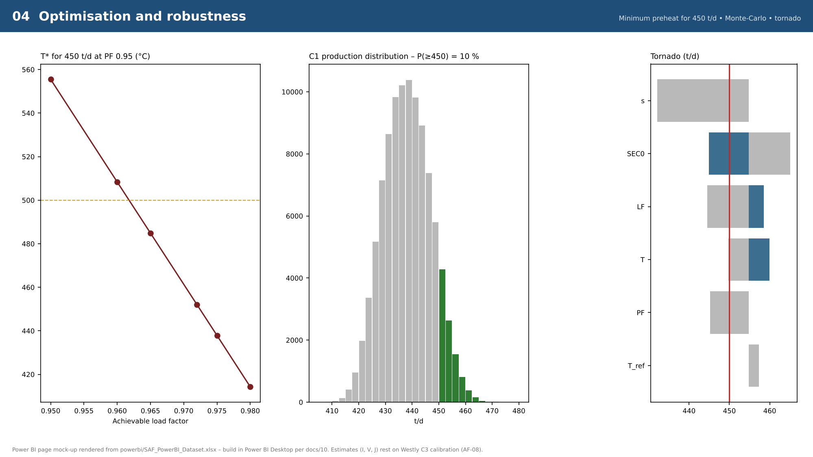
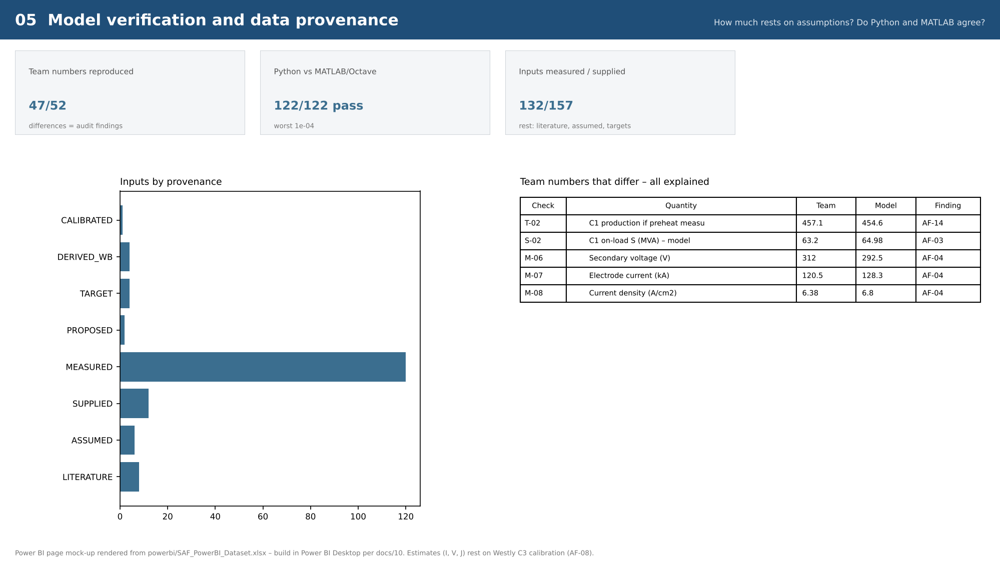

::: {custom-style="Appendix Heading"}
B.1 Purpose
:::

The Power BI dashboard (Microsoft, n.d.) is the decision-support tool of the project. Each of its five pages answers one engineering question, and every value on it comes from the verified model. No number is typed into Power BI: when an input changes, the model is run again and the dashboard is refreshed. The report pages were rendered from the same dataset to show the intended layout; the Power BI file itself (.pbix) is built in Power BI Desktop from the dataset and the build guide, which takes about ten minutes.

::: {custom-style="Table Caption"}
Table B.1: Files of the Power BI pack
:::

| File | Use |
|---|---|
| `SAF_PowerBI_Dataset.xlsx` | 15 tables in a star schema; the only data source |
| `SAF_measures.dax` | All DAX measures |
| `SAF_theme.json` | Colour theme |
| `PowerBI_Dashboard_Build_Guide` | Step-by-step build, with the fields of every visual |
| `PBI_page1` to `PBI_page5` | Page layouts, shown in Figures B.1 to B.5 |

::: {custom-style="Appendix Heading"}
B.2 Data model
:::

The dataset holds eight scenarios with 24 electrical and production metrics each, seven acceptance criteria with their utilisation, the mass balance and its residuals, the optimisation results, the Monte Carlo histogram, the tornado data, 52 verification checks, 122 cross-validation comparisons and the provenance tag of all 157 model inputs. Three relationships join the facts to the scenario and metric tables (scenario identifier and metric name, many to one, single direction).

::: {custom-style="Table Caption"}
Table B.2: Pages of the dashboard
:::

| Page | Question answered | Main visuals |
|---|---|---|
| 1 Baseline against C1 | What does the selected design change? | Six cards, production by scenario against 450 t/d, utilisation of each criterion |
| 2 Transformer and electrical loading | Is there headroom, and which 60 MW is meant? | On-load MVA against 65, current density, scenario table |
| 3 Mass balance and metallurgy | What goes in and out per tonne, and are the data consistent? | Stream bars, residuals within ±3 %, daily duties |
| 4 Optimisation and robustness | What is the least intervention, and how sure are we? | Minimum preheat, Monte Carlo histogram, tornado, robust temperatures |
| 5 Verification and provenance | How much rests on assumptions, and do the models agree? | Checks reproduced, cross-validation, count by provenance |

{width=5.6in}

::: {custom-style="Figure Caption"}
Figure B.1: Dashboard page 1, baseline against the selected design C1.
:::

{width=5.6in}

::: {custom-style="Figure Caption"}
Figure B.2: Dashboard page 2, transformer and electrical loading.
:::

{width=5.6in}

::: {custom-style="Figure Caption"}
Figure B.3: Dashboard page 3, mass balance and metallurgy.
:::

{width=5.6in}

::: {custom-style="Figure Caption"}
Figure B.4: Dashboard page 4, optimisation and robustness.
:::

{width=5.6in}

::: {custom-style="Figure Caption"}
Figure B.5: Dashboard page 5, model verification and data provenance.
:::

Every page footer states that the electrode current, voltage and current density are estimates (audit finding AF-08). Red is used only for a failed criterion or a risk and green only for a pass, so that colour carries engineering meaning.
