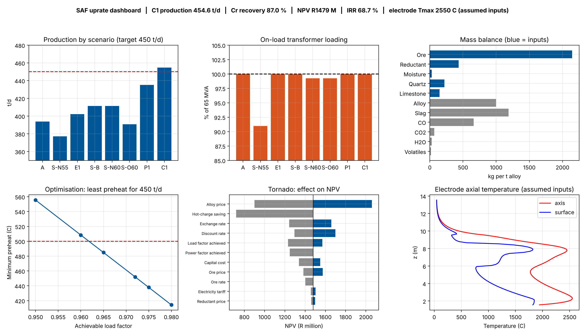

::: {custom-style="Appendix Heading"}
C.1 MATLAB scripts and cross-validation
:::

Every calculation was programmed twice: in Python, which is the reference model, and independently in MATLAB (MathWorks, n.d.), which was run in GNU Octave (GNU Octave, n.d.) because MATLAB itself was not available. The MATLAB scripts read only the numeric input files and use functions that exist in both programs, so they run unchanged in MATLAB.

::: {custom-style="Table Caption"}
Table C.1: MATLAB scripts and the result of the comparison with Python
:::

| Script | Calculation | Result of the comparison |
|---|---|---|
| `saf_electrical_I1.m` | Eight electrical scenarios | 104 of 104 values agree, worst relative difference 3.5 × 10⁻¹⁵ |
| `saf_massbalance_I2.m` | Mass balance by non-negative least squares (`lsqnonneg`) | Five stream masses and the recovery agree to about 10⁻¹⁵; part of the 18 of 18 comparisons |
| `saf_optimum_I2.m` | Least preheat temperature and closed form | Part of the 18 of 18 comparisons of the mass balance and the optimisation, all agreeing |
| `saf_npv_ch16.m` | Net present value and IRR (`fzero`) | NPV agrees to 2 × 10⁻¹⁵ |
| `octave_check.m` | Thermal model of the electrode | Maximum temperature difference 1.5 × 10⁻¹¹ °C on 5 712 cells |
| `saf_dashboard.m` | Dashboard of six panels | See C.2 |

::: {custom-style="Appendix Heading"}
C.2 MATLAB dashboard
:::

The script `saf_dashboard.m` draws six panels and a strip of key figures from numeric files written by the model: the production and the transformer loading of each scenario, the mass balance, the least preheat temperature against load factor, the tornado of the net present value and the axial temperature of the electrode. It is run in MATLAB with `saf_dashboard('dashboard_matlab.png')`.

The graphics driver of the Octave installation used here could not render figures, so only the data-reading part of the script was run (`saf_dashboard('dry')` reads all files and reports their sizes). Figure C.1 is a rendering of the same six panels, drawn with matplotlib from the same files, and the plotting commands of the script itself should be run once in MATLAB before the dashboard is shown.

{width=6.3in}

::: {custom-style="Figure Caption"}
Figure C.1: The six panels of the MATLAB dashboard, rendered from the files in `matlab/dashboard_data`.
:::
