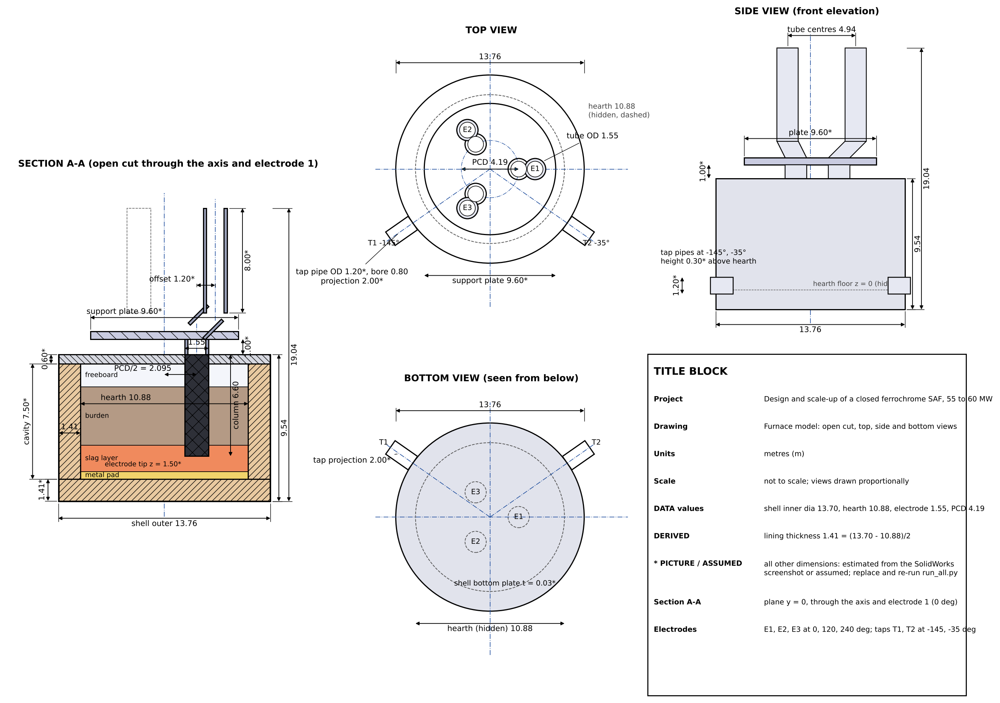
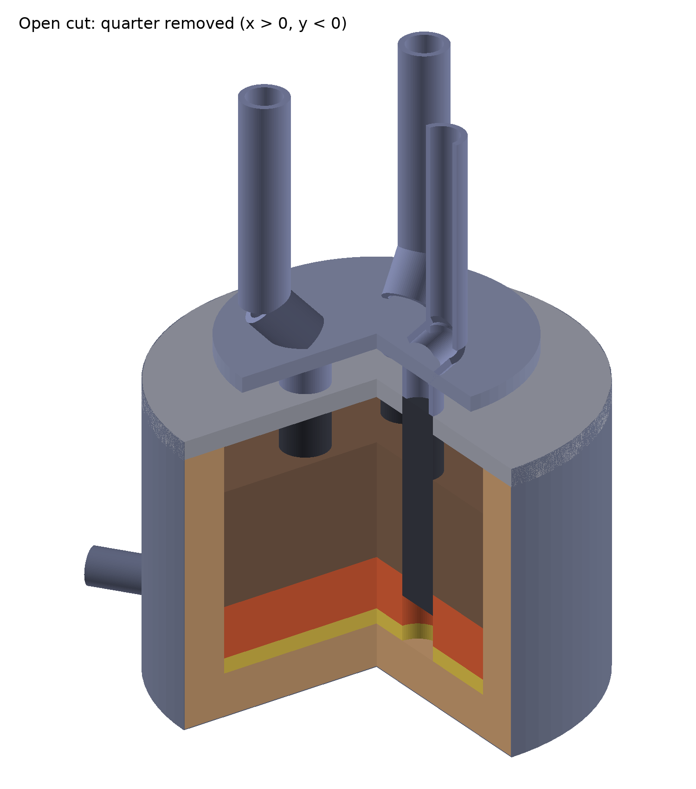
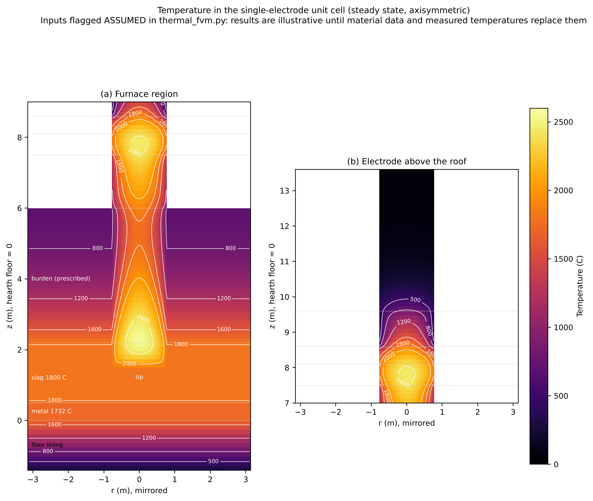
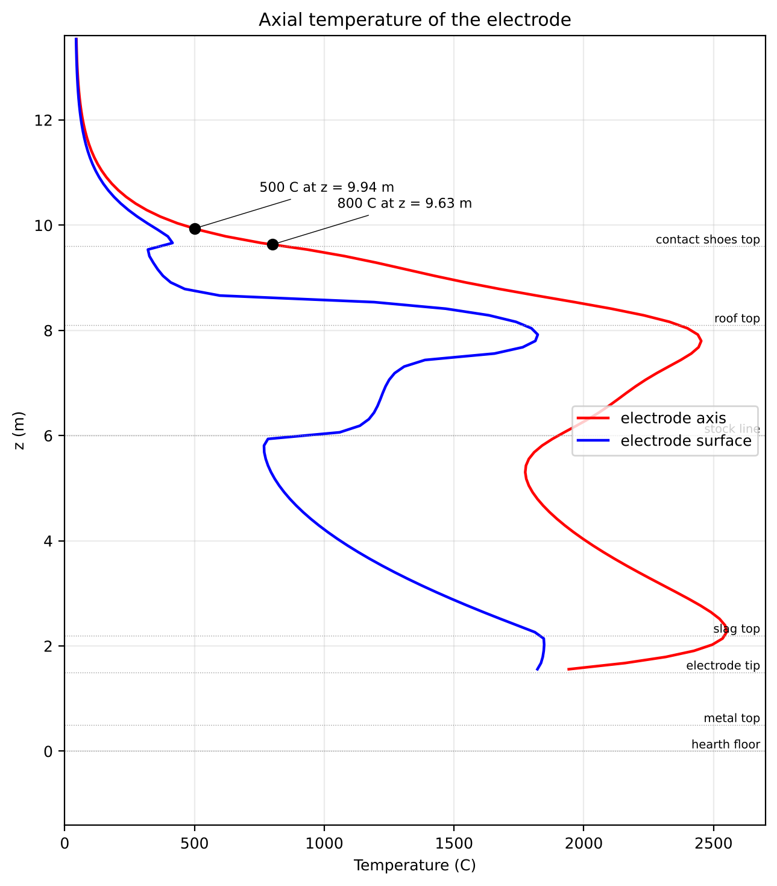
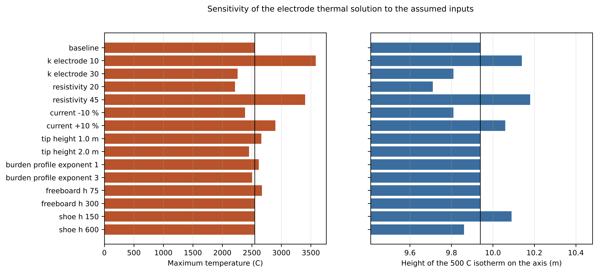

# 1. What was built

The furnace in the SolidWorks screenshot (a cylindrical shell, three electrodes with angled feet on a raised support plate, and two tap pipes at the hearth level) was rebuilt as a parametric 3D model. From it the following were produced:

| Item | File |
|---|---|
| Parametric dimensions with their source tags | `params.py`, `cad_files/furnace_parameters.json` |
| 3D assembly with named bodies (shell, lining, roof, metal pad, slag layer, burden, electrodes, taps) | `cad_files/furnace_assembly.step` |
| Single solid, and a quarter open cut | `furnace_solid.step`, `furnace_open_cut_quarter.step` (and `.stl`) |
| Revolve-cut sketch (half-section profile, with the cavity on its own layer) | `cad_files/revolve_cut_profile_half_section.dxf` |
| 2D views with dimensions: open cut, top, side, bottom, and one drawing sheet | `images/view_*.png/.pdf/.svg`, `images/furnace_drawing_sheet.png/.pdf` |
| Shaded isometric views, full and open cut | `images/iso_full.png`, `images/iso_open_cut_quarter.png` |
| Thermal model (finite volume, axisymmetric), results, figures | `thermal_fvm.py`, `thermal_run.py`, `thermal_results/`, `images/thermal_*.png` |
| Independent MATLAB/Octave check of the thermal solver | `octave_check.m` |

The STEP and DXF files are neutral formats. They open in SolidWorks (File, Open; or Insert, DXF for the revolve sketch) and can be imported into COMSOL (CAD Import Module, or Geometry, Import). I could not run SolidWorks or COMSOL here, so the files were checked by volume and by re-reading, not by opening them in those programs.

# 2. Dimensions: what is data and what is estimated

The screenshot carries no dimensions. Every value is therefore tagged. Four values come from the project data and the design basis. Everything else was scaled from the proportions of the picture or assumed, and is marked with an asterisk on the drawings.

| Dimension | Value (m) | Source |
|---|---|---|
| Shell inner diameter | 13.70 | DATA (Chapter 3) |
| Hearth diameter inside the lining | 10.88 | DATA (Chapter 3) |
| Electrode diameter | 1.55 | DATA (Chapter 4, A-16) |
| Pitch circle diameter | 4.19 | DATA (A-19) |
| Lining thickness | 1.41 | DERIVED, (13.70 - 10.88)/2 |
| Steel shell plate | 0.03 | ASSUMED |
| Overall height of the shell body | 9.54 | PICTURE (cavity 7.50, roof 0.60, floor 1.41, plate 0.03) |
| Support plate diameter and thickness | 9.60, 0.50 | PICTURE |
| Stub height, tube length, foot offset | 1.00, 8.00, 1.20 | PICTURE |
| Tap pipe outer diameter, bore, projection, height | 1.20, 0.80, 2.00, 0.30 | PICTURE |
| Process levels: metal 0.50, slag top 2.20, stock line 6.00, electrode tip 1.50 | m above the hearth floor | ASSUMED |

**Choice made.** In the picture the electrode tubes are thicker and further apart than the project data allow (the picture implies a tube diameter of about 2.2 m and a pitch circle of about 7.7 m). The model follows the data for the electrodes and the pitch circle, and the picture for everything the data are silent on. To use the SolidWorks values instead, edit `params.py` and run `python3 run_all.py`; every view, file and the thermal mesh are rebuilt from it.

{width=6.3in}

{width=4.6in}

The hearth cavity is a true revolve cut: a cylinder of lining is cut by the revolved half-profile (r from 0 to 5.44 m, z from 0 to 7.50 m). The CAD lining volume, 616.15 m³, equals the analytic revolve volume to 13 digits.

# 3. Thermal model of the electrode

**Purpose.** To show how the temperature is distributed in an electrode and its surroundings, in the way a COMSOL Heat Transfer model would, and to locate the baking zone of the Søderberg paste. (In a three-phase AC furnace the electrodes are not cathodes; the study treats each electrode as a current-carrying heat source.)

**Domain.** One electrode and the equal-area slice of the furnace around it: radius R = 10.88 / (2 sqrt 3) = 3.14 m, from the bottom of the floor lining (z = -1.41 m) to 4 m above the support plate (z = 13.6 m). Axisymmetric.

**Equations.** Steady heat conduction with a volumetric source, div(k grad T) + q = 0.

- The source in the electrode is the Joule heat of the 50 Hz current, including the skin effect, q(r) = rho |J(r)|^2, with J(r) proportional to I0(kr), k = (1 + j)/delta, and delta = sqrt(2 rho / (omega mu0)) = 0.48 m. The total current is the 130.1 kA estimated for design C1 (Chapter 10, an estimate, not a measurement). Joule heating stops above the contact shoes.
- The slag layer is fixed at 1 800 C (DATA, in-furnace slag temperature, Slag sheet) and the metal pad at 1 732 C (DATA, liquidus plus superheat, Metal sheet).
- The burden temperature is prescribed from the process: it falls from the slag temperature at the bath to the gas temperature at the stock line. A conduction model cannot represent the gas-solid heat exchange and the reactions of the charge, so this is stated as an assumption and not solved.
- Free surfaces use a film coefficient to the local environment; the cell edge is adiabatic (symmetry); the shell bottom loses heat to ambient.

**Inputs.** All inputs are tagged in `thermal_fvm.py`. The ones that matter most are assumptions with no plant data behind them.

| Input | Value | Tag |
|---|---|---|
| Slag temperature, metal temperature | 1 800, 1 732 C | DATA, DERIVED |
| Electrode current | 130.1 kA | DERIVED (estimate) |
| Electrode resistivity | 30 micro-ohm m | ASSUMED (range 20 to 45 tested) |
| Electrode conductivity | 20 W/(m K) | ASSUMED (range 10 to 30 tested) |
| Lining conductivity | 3 W/(m K) | ASSUMED |
| Film coefficients: freeboard 150, roof 30, shoes 300, above shoes 15 | W/(m2 K) | ASSUMED |
| Gas, roof and air temperatures: 700, 60, 40 C | C | ASSUMED |
| Contact shoes: top at z = 9.6 m, band 1.0 m deep | m | ASSUMED |

# 4. Results

{width=6.3in}

| Quantity | Value |
|---|---|
| Joule heat in one electrode | 2.74 MW |
| Net heat from the electrode to the slag, metal and burden | 1.46 MW |
| Heat lost from the electrode surface (freeboard, roof, shoes) | 1.18 MW |
| Heat lost through the floor of the cell | 0.10 MW |
| Highest temperature, inside the electrode | 2 550 C (2 220 to 3 580 C over the cases tested) |
| Electrode surface at the stock line | about 770 C |
| 500 C isotherm on the axis (baking zone) | z = 9.94 m, 0.34 m above the top of the contact shoes |
| 800 C isotherm on the axis | z = 9.63 m |

{width=4.6in}

{width=6.3in}

**How to read the results.** The temperature of the slag, the metal and the floor lining follows from plant data and is reliable to the accuracy of those data. The temperature inside the electrode is not: it is set by the assumed resistivity, conductivity and cooling, and it moves by more than 1 000 C over the range tested (k from 10 to 30 W/(m K) gives 3 580 to 2 260 C). The position of the baking zone moves by only about 0.5 m. The study is therefore useful now to rank the effect of each input, and to locate the baking zone relative to the contact shoes. It becomes a prediction only when the electrode material data and one measured temperature profile are supplied.

# 5. Validation

| Check | Result |
|---|---|
| Analytic case, long cylinder with uniform source and fixed surface temperature, T(0) = Ts + q R^2/(4 k) | 1 101.0417 C against 1 101.0417 C, relative error 3.5e-8 |
| Mesh convergence, 1 440 to 22 992 cells | maximum temperature 2 551.4, 2 550.4, 2 550.3 C; 500 C isotherm 9.941, 9.937, 9.933 m |
| Energy balance of the whole cell | residual 1.5e-8 W on 2.7 MW |
| Independent MATLAB/Octave assembly and solution of the same arrays | maximum difference 1.5e-11 C on 5 712 cells |
| CAD lining volume against the analytic revolve volume | 616.1526 m³ against 616.1526 m³ |

The Octave check uses the same fields (conductivities, sources, boundary data), so it verifies the numerical solution, not the choice of boundary conditions.

# 6. Limits, and what is needed to improve it

- The model is a single-electrode, axisymmetric cell. A three-phase furnace is not axisymmetric, so the interaction between electrodes, the current paths in the bath and the arc are outside it. A 3D model of the STEP geometry is the next step in COMSOL.
- The burden temperature is prescribed and the study is steady state. A transient study of start-up or of a power increase needs the heat capacities of the materials.
- Needed from you: the SolidWorks dimensions (to replace the picture estimates), the electrode paste and refractory material data, and at least one measured temperature (for example the baking-zone height or a thermocouple reading) to calibrate against.
