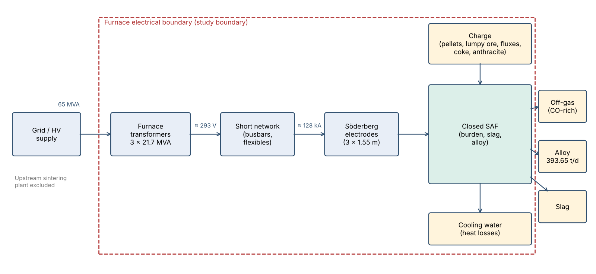

# CHAPTER 4 – DESIGN BASIS

*Author: T. Motsemme · Revision B (academic draft) · Checked by: Simphiwe – pending*

## 4.1 Introduction

The design basis establishes the fixed technical foundation upon which every subsequent calculation, evaluation and recommendation in this report rests. It defines the design problem, the boundary of the system under study, the hierarchy of data sources, the operating scenarios to be compared and the criteria against which any proposed modification is judged. A clearly stated design basis is essential in brownfield uprating studies, where the temptation is to assume that existing equipment can absorb additional duty. In practice the feasibility of an uprate is decided by the most constrained component in the system, so that constraint must be identified explicitly (Mulholland, 2009).

This chapter is structured as follows. Section 4.2 states the design problem and its requirements. Section 4.3 defines the system boundary. Section 4.4 sets out the hierarchy and provenance of the design data. Section 4.5 defines the electrical operating parameters. Section 4.6 describes the design scenarios. Sections 4.7 and 4.8 present the design data. Section 4.9 lists the applicable standards. Section 4.10 states the acceptance criteria. Section 4.11 discusses the limitations of the data.

## 4.2 Design Problem and Requirements

### 4.2.1 Problem statement

The study addresses the following question: *how can an existing closed, three-phase ferrochrome submerged arc furnace (SAF) be uprated from its present operating power to 60 MW on its existing 65 MVA transformer installation, while retaining the existing furnace infrastructure and maintaining safe, stable and efficient metallurgical operation?* The plant data supplied by the supervisor (Ferrochrome Data Workbook, 2026) adds a production requirement: the furnace currently produces 393.65 t/d of alloy, against a target of 450 t/d that has not yet been achieved.

### 4.2.2 Requirements

Following established practice in engineering system design, the requirements are separated into functional requirements, performance requirements and constraints (Table 4.1).

**Table 4.1:** Design requirements

| Category | Requirement |
|---|---|
| Functional | Produce high-carbon (charge-grade) ferrochrome from the existing charge of chromite pellets, lumpy ore, quartz, limestone, coke and anthracite in the existing closed SAF |
| Performance | (i) Raise the mean active power towards 60 MW; (ii) raise alloy production to ≥ 450 t/d; (iii) maintain alloy quality and chromium recovery; (iv) maintain operational stability |
| Constraints | (i) Transformer rating fixed at 65 MVA; (ii) furnace shell, hearth and roof retained; (iii) power factor not above 0.95 (supervisor's limit); (iv) existing auxiliaries (cooling water, off-gas cleaning, feed and tapping systems) to be modified only where justified |

## 4.3 System Definition and Boundary

The system under study is bounded at the **furnace electrical boundary** (Figure 4.1). The boundary encloses the furnace transformers, the secondary circuit (busbars and flexible conductors, known collectively as the short network), the three Söderberg electrodes and the furnace vessel with its burden, slag and alloy. Material crosses the boundary as charge entering and alloy, slag, CO-rich off-gas and heat (to the cooling water) leaving. The upstream sintering plant lies outside the boundary, consistent with the definition of the specific energy in the plant data (Ferrochrome Data Workbook, 2026).

**Figure 4.1:** System boundary of the study. Electrical values are the estimated existing operating point (Chapter 7).

## 4.4 Hierarchy and Provenance of Design Data

The design data come from sources of differing reliability. To ensure traceability, a hierarchy is adopted (Table 4.2). Where two sources conflict, the higher-ranked source governs. Every numerical value in this report carries a provenance tag, so that measured plant data are never confused with assumptions or literature estimates.

**Table 4.2:** Hierarchy of design data sources

| Rank | Source | Tag | Typical content |
|---|---|---|---|
| 1 | Supervisor-confirmed plant data (Ferrochrome Data Workbook, 2026) | [WB] | Power factor, specific energy, production, raw material, alloy and slag analyses |
| 2 | Project brief | [S] | 55 → 60 MW uprate; 65 MVA transformers; closed SAF |
| 3 | Published literature | [L] | Electrode diameter, furnace geometry, scale-up relations |
| 4 | Documented assumptions | [A] | HV supply voltage, preheat temperature |
| – | Values calculated in this study | [C] | Mean power, currents, ore blend, recovery check |

The plant data themselves distinguish values that are *measured*, *supplied*, *assumed*, *calibrated*, *derived* or *targets*. This distinction is preserved here. Two points are of particular importance. The load factor of 0.95 was back-solved from production and was not measured independently. The figure of 450 t/d is a target, not the current baseline (Ferrochrome Data Workbook, 2026).

## 4.5 Definition of Electrical Operating Parameters

Because the transformer rating is fixed, it is necessary to distinguish between the power drawn while the furnace is on load and the power averaged over time. The following definitions are used throughout:

*P*~on~ = *S* · PF  (4.1)

*P*~mean~ = *S* · PF · LF  (4.2)

*E*~d~ = 24 · *P*~mean~  (4.3)

*M* = *E*~d~ / SEC  (4.4)

where *S* is the transformer rating (MVA), PF the power factor, LF the load factor (the fraction of time at full load), *P*~on~ the on-load active power (MW), *P*~mean~ the mean active power (MW), *E*~d~ the daily electrical energy (MWh/d), SEC the specific electrical energy (MWh/t alloy) and *M* the daily alloy production (t/d). Equation (4.4) expresses the central relationship of this study: at a fixed transformer rating, production can be increased only by raising PF or LF, or by lowering SEC.

**Interpretation of the brief's 55 MW.** The brief describes the existing furnace as operating at "approximately 55 MW". The plant data give *P*~mean~ = 57.43 MW, and this value reproduces the measured production (Chapter 7). If the 55 MW refers to the power delivered to the bath, the implied secondary-circuit efficiency is 55/57.43 = 0.958, which is typical of the 0.94–0.98 range assumed for SAF secondary circuits. Alternatively, the figure may be a rounded nominal value. Since all calculations use the plant data, the interpretation does not affect the results, but it is recorded as an open item (A-25) for confirmation by the supervisor.

## 4.6 Design Scenarios

Three cases are defined (Table 4.3). In accordance with the comparison principle adopted for this study, all scenarios use the same raw materials, alloy grade and calculation methods. Only the variables of the alternative under evaluation are changed, so that differences in performance can be attributed to the alternative itself.

**Table 4.3:** Design scenarios

| Scenario | Description | Defining values |
|---|---|---|
| A – Existing | Present operation | *S* = 65 MVA; PF = 0.93; LF = 0.95; *P*~mean~ = 57.43 MW; SEC = 3.5 MWh/t; *M* = 393.65 t/d; sintered pellets charged cold |
| B – Electrical uprate | 60 MW mean active power on the same transformers | PF · LF ≥ 60/65 = 0.923 |
| T – Production target | Supervisor's production target | *M* ≥ 450 t/d, requiring SEC ≤ 3.06 MWh/t at 57.43 MW or ≤ 3.20 MWh/t at 60 MW |

## 4.7 Design Data

### 4.7.1 Electrical and production data

**Table 4.4:** Electrical and production data (Ferrochrome Data Workbook, 2026)

| Parameter | Value | Unit | Status |
|---|---|---|---|
| Transformer capacity | 65 | MVA | Fixed constraint |
| Power factor | 0.93 | – | Assumed; accepted by supervisor (≤ 0.95 acceptable) |
| Load factor | 0.95 | – | Calibrated (back-solved) |
| Mean active power | 57.43 | MW | Derived |
| Daily energy | 1378.3 | MWh/d | Derived |
| Specific energy (cold sintered pellets) | 3.5 | MWh/t | Supplied; confirmed by supervisor |
| Production (actual) | 393.65 | t/d | Supplied (393.5–393.8 t/d) |
| Production targets | 450; 480 | t/d | Targets |
| Specific energy target (hot, pre-reduced pellets) | 2.41 | MWh/t | Target |
| Pellet metallisation target (Fe + Cr) | 40–50 | % | Target |
| Chromium recovery: baseline / target | 78 / 93 | % | Assumed / target |

### 4.7.2 Charge recipe and raw materials

The charge recipe is specified as the split of each material *within* its group (Table 4.5). The ratios *between* the ore, flux and reductant groups are not given and are determined by the mass balance (Chapter 8).

**Table 4.5:** Charge recipe (within-group fractions)

| Group | Composition |
|---|---|
| Ore | 80 % pellets; 20 % small lumpy ore |
| Flux | 55 % quartz; 45 % limestone |
| Reductant | 10 % coke; 54 % anthracite 1; 36 % anthracite 2 |

**Table 4.6:** Mean chemical analyses of ore and fluxes (mass %)

| Material | Cr₂O₃ | FeO | Al₂O₃ | MgO | SiO₂ | CaO | TiO₂ | Cr/Fe |
|---|---|---|---|---|---|---|---|---|
| Pellets | 39.76 | 25.00 | 15.61 | 9.48 | 7.02 | 0.65 | 0.81 | 1.40 |
| Small lumpy ore | 38.65 | 23.25 | 15.51 | 11.05 | 9.02 | 1.17 | 0.74 | 1.47 |
| Quartz | – | – | 1.00 | 0.07 | 96.88 | 0.03 | 0.01 | – |
| Limestone | – | – | 0.52 | 5.89 | 1.52 | 46.59 | – | – |

**Table 4.7:** Mean proximate analyses of reductants (mass %)

| Reductant | Fixed carbon | Ash | Volatile matter | Total moisture | S (XRF) |
|---|---|---|---|---|---|
| Coke | 81.75 | 16.50 | 1.42 | 15.68 | 0.71 |
| Anthracite 1 | 82.02 | 14.06 | 3.52 | 6.45 | 0.24 |
| Anthracite 2 | 81.49 | 13.27 | 5.01 | 2.96 | 0.66 |

### 4.7.3 Alloy and slag

**Table 4.8:** Mean alloy and slag compositions and temperatures (five samples each)

| Alloy | Cr | Fe | Si | C | Ti | Mn | P | S | Liquidus | Tap temperature |
|---|---|---|---|---|---|---|---|---|---|---|
| mass % / °C | 50.42 | 35.99 | 3.64 | 6.71 | 0.64 | 0.24 | 0.017 | 0.02 | 1550 | 1732 |

| Slag | Al₂O₃ | CaO | Cr₂O₃ | FeO | MgO | SiO₂ | (CaO+MgO)/SiO₂ | Liquidus (FactSage) | In-furnace temperature |
|---|---|---|---|---|---|---|---|---|---|
| mass % / °C | 30.23 | 7.55 | 9.54 | 5.80 | 18.22 | 27.23 | 0.95 | 1757 | 1800 |

The measured mean slag Cr₂O₃ content of 9.54 % replaces a previously supplied value of 15 %. The plant data describe this as a correction of an error, not an adjustment of a design value (Ferrochrome Data Workbook, 2026).

## 4.8 Data Not Contained in the Plant Data Set

The plant data contain no secondary-circuit electrical measurements (voltage taps, electrode current) and no furnace dimensions. These are taken from published data for South African ferrochrome furnaces of comparable size, and from documented assumptions (Table 4.9). All of these values carry lower confidence than the plant data and are subjected to sensitivity analysis (Chapter 16).

**Table 4.9:** Design data from literature and assumptions

| Parameter | Value | Basis |
|---|---|---|
| Electrode type and diameter | Söderberg; 1.55 m | Published 63 MVA South African ferrochrome furnaces (*Wear analysis of tap-holes…*, 2019)† |
| Pitch circle / hearth / shell inner diameter | 4.19 m / 10.88 m / 13.7 m | Geometric ratios of published ferrochrome furnaces† (A-19, A-20) |
| Scale-up constant C₃ (electrode current) | 8.33 | Westly (1974) relation calibrated on a published 48 MW furnace† (A-18) |
| HV supply voltage | 132 kV (88 kV sensitivity) | Assumption A-21 |
| Existing secondary tap range | 260–340 V | Assumption A-23 |
| Auxiliary-plant design margin | 10 % | Assumption A-22 |

## 4.9 Applicable Standards

Transformer rating and loading follow IEC 60076-1 (IEC, 2011), and the requirements for furnace transformers follow IEEE Std C57.17. Short-circuit forces on conductors are assessed using IEC 60909. Power-quality aspects (harmonics, flicker and unbalance) are governed by IEC 61000-3-6, IEC 61000-3-7 and, for the South African grid, NRS 048-2. Power quality is identified but lies outside the detailed scope of this study.

## 4.10 Acceptance Criteria

A proposed configuration is acceptable only if it satisfies every criterion in Table 4.10, or if a deviation is formally justified and mitigated. Criteria DC-02, DC-14 and DC-15 are **mandatory gates**: an alternative that fails them is not carried forward to weighted evaluation (Chapter 12). Limits marked ◇ are provisional and are to be justified by the responsible author.

**Table 4.10:** Acceptance criteria

| ID | Criterion | Acceptance limit |
|---|---|---|
| DC-01 | Transformer apparent power | *S* ≤ 65 MVA (continuous) |
| DC-02 | Power factor (gate) | 0.93 ≤ PF ≤ 0.95 |
| DC-03 | Secondary voltage | Within the tap range with ≥ ±5 % control margin ◇ |
| DC-04 | Electrode current density | Not above the existing operating value ◇ |
| DC-05 | Electrode current | Not above the existing holder and clamp loading ◇ |
| DC-06 | Cooling-water heat removal | ≤ 90 % of design capacity ◇ |
| DC-07 | Refractory and shell | Within design heat flux and temperature |
| DC-08 | Structural loads | Within rated capacity |
| DC-09 | Chromium recovery | Not below the baseline determined in Chapter 8 |
| DC-10 | Specific energy | ≤ 3.5 MWh/t |
| DC-11 | Off-gas, feed and tapping capacity | ≥ the duty at the new production rate |
| DC-12 | Operational stability | Within the stable electrode-control region |
| DC-13 | Economics | Positive net present value ◇ |
| DC-14 | Production (gate) | ≥ 450 t/d |
| DC-15 | Alloy quality (gate) | Cr, Si, C, S and P within present ranges; positive slag superheat |

## 4.11 Limitations of the Design Data

Several limitations of the design data are acknowledged:
* The plant data do not state whether the ore analyses are on an as-received or a dry basis.
* The reported mean fixed carbon of both anthracites exceeds their specification maximum, and their volatile matter is below the specification minimum.
* The mean SiO₂ content of the lumpy ore (9.02 %) is below its specification minimum (9.50 %).
* Two slag samples show artefacts of the thermodynamic model: a negative superheat and a negative spinel fraction.
* The baseline chromium recovery of 78 % is an assumption. Chapter 7 shows that it is inconsistent with an oxide tracer balance.
* No secondary-circuit electrical data are available, so the electrode current and secondary voltage are estimates (Section 4.8).

These limitations do not prevent the study from proceeding. They are, however, carried forward into the sensitivity and risk assessments.

## 4.12 Summary

The design basis defines a power-limited, brownfield uprating problem on a fixed 65 MVA supply with two performance requirements: 60 MW mean power and 450 t/d production. Supervisor-confirmed plant data govern all other sources. Literature values are used only where plant data are absent, and they are explicitly identified as such. Equation (4.4) shows that production can be raised only through the power factor, the load factor or the specific energy. This observation frames the development of alternatives in Chapter 12.

## References

Ferrochrome Data Workbook (2026) *Ferrochrome smelting – data workbook: consolidated plant inputs, charge recipe, raw materials, metal, slag and process assumptions*. Unpublished plant data set supplied by the project supervisor.

IEC (2011) *IEC 60076-1: Power transformers – Part 1: General*. Geneva: International Electrotechnical Commission.

IEEE (current edition) *IEEE Std C57.17: Requirements for arc furnace transformers*. New York: Institute of Electrical and Electronics Engineers.

Mulholland, A.C. (2009) 'The effectiveness of current control of submerged arc furnace electrode penetration in selected scenarios', *Journal of the Southern African Institute of Mining and Metallurgy*, 109(10).†

Westly, J. (1974) 'Resistance and heat distribution in a submerged-arc furnace', *Proceedings of the First International Ferro-Alloys Congress (INFACON 74)*. Johannesburg: SAIMM.†

*Wear analysis of tap-holes at two ferrochromium production furnaces* (2019) *Journal of the Southern African Institute of Mining and Metallurgy*, 119(6). [Authors to be confirmed.]†

† Consulted at abstract level; to be verified against the full text before submission (reference register, document 05).
