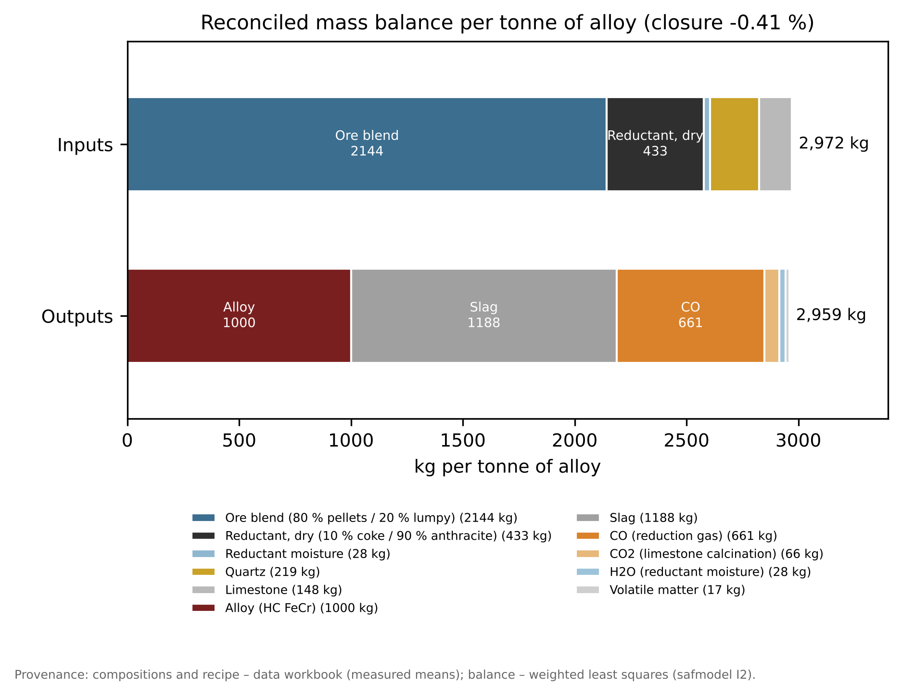
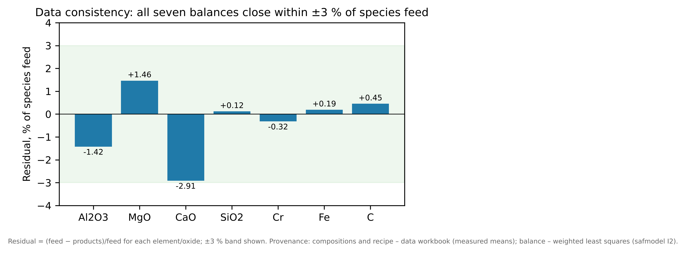
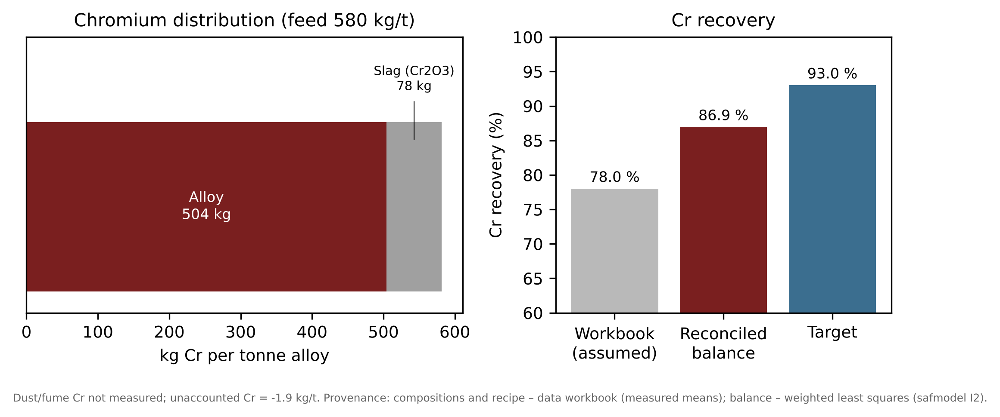
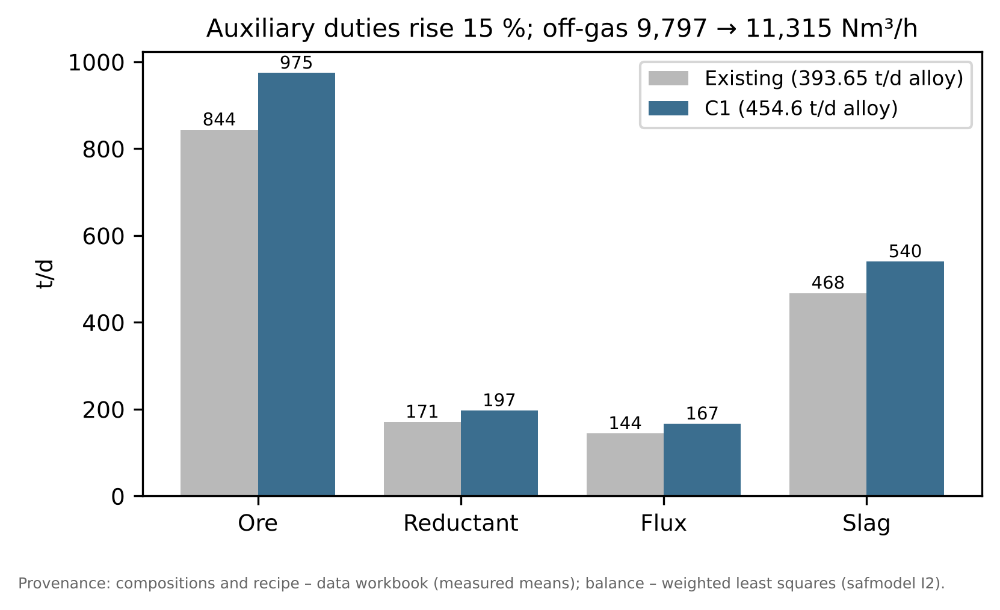
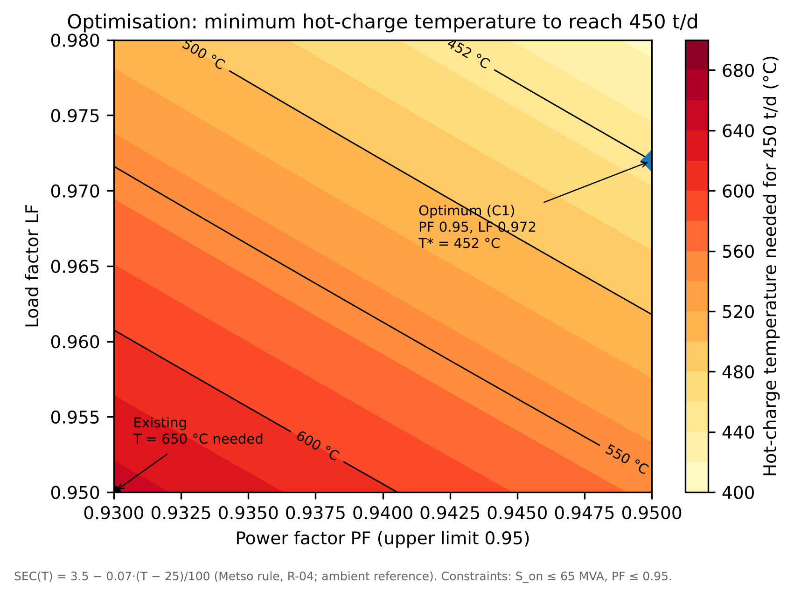
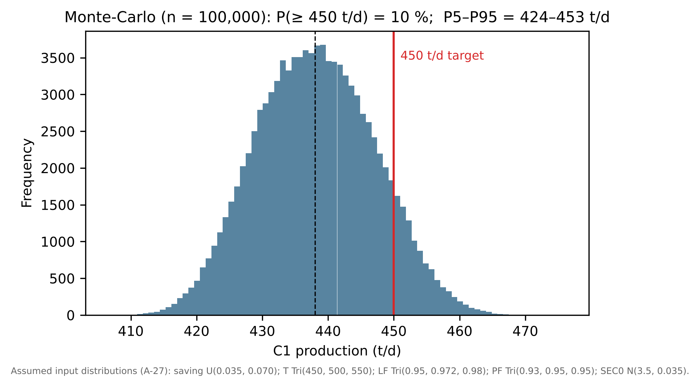
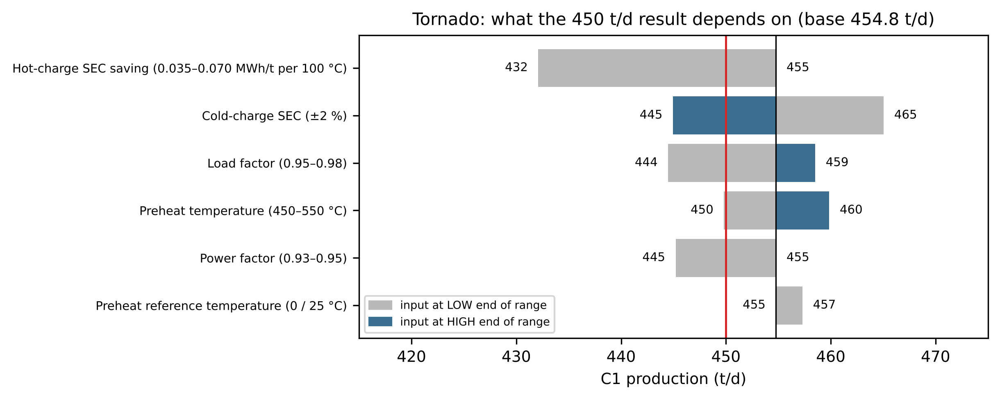
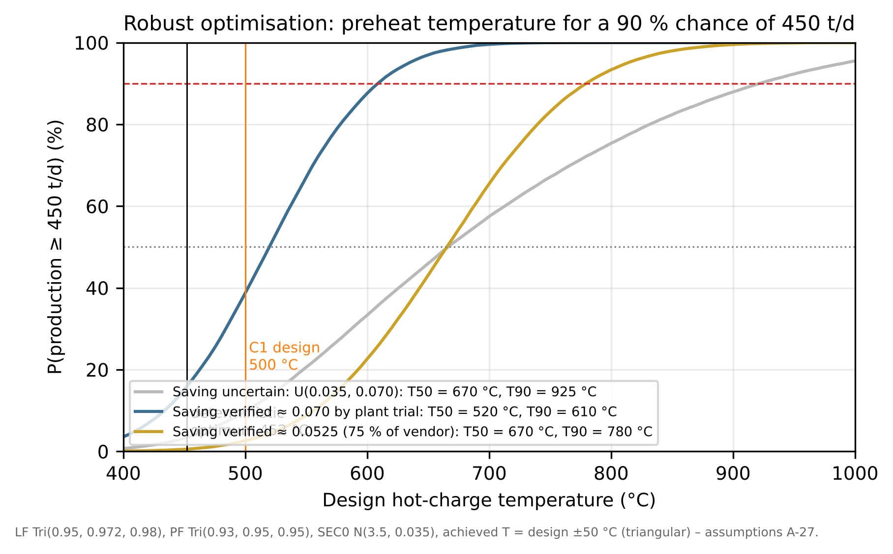

# CHAPTER 8 – MASS BALANCE AND OPTIMISATION STUDY

*Ferrochrome SAF uprate (55 → 60 MW, 65 MVA) · Revision A · Model: safmodel v0.2 (Python), cross-validated in MATLAB/Octave*

## 8.1 Introduction

The mass balance quantifies the raw materials consumed and the products, slag and gas generated per tonne of alloy. It also determines the chromium recovery, which the plant data list only as an assumption (78 %). The production increase proposed in Chapter 12 changes every daily duty in proportion: ore handling, reductant supply, slag tapping and off-gas cleaning. A defensible balance is therefore a precondition for the equipment, economic and risk assessments.

The plant data contain the analyses of every input and output stream, but **no stream mass flows**. This chapter therefore treats the balance as a **data-reconciliation problem**. The unknown stream masses are those that best satisfy all element and oxide conservation equations simultaneously, given the measured compositions. The residuals of the solution measure how consistent the plant data are.

The second part of the chapter (Section 8.8) describes how the selected design was optimised, and tests how robust that optimum is to uncertainty.

## 8.2 Basis and assumptions

**Table 8.1:** Basis of the mass balance

| Item | Basis | Provenance |
|---|---|---|
| Basis | 1 tonne (1000 kg) of alloy | – |
| Ore blend | 80 % sintered pellets + 20 % small lumpy ore (mean analyses) | Data workbook – supplied recipe, measured analyses |
| Reductant blend | 10 % coke + 54 % anthracite 1 + 36 % anthracite 2 | Data workbook |
| Fluxes | Quartz and limestone; split **not** imposed | Data workbook analyses |
| Alloy | Cr 50.42, Fe 35.99, Si 3.64, C 6.71 % (mean of 5) | Measured |
| Slag | Al₂O₃ 30.23, CaO 7.55, Cr₂O₃ 9.54, FeO 5.80, MgO 18.22, SiO₂ 27.23, C 0.22 % | Measured |
| Reductant basis | Proximate analyses taken as **dry basis** (fixed carbon + ash + volatiles ≈ 100 %) | Assumption A-26 |
| Reduction gas | All oxygen removed by reduction leaves as CO (reducing conditions, closed furnace) | Engineering assumption |
| Dust and fume | Not measured, so not included | Data gap |
| Minor elements | Ti, Mn, P, S and V in the alloy are not balanced (< 1.3 % of alloy mass) | Simplification |

## 8.3 Formulation

Five unknown stream masses per tonne of alloy were defined: ore *m*~o~, dry reductant *m*~r~, quartz *m*~q~, limestone *m*~l~ and slag *m*~s~. Seven conservation equations were written:

1. Al₂O₃, MgO and CaO (inert oxides): feed = slag  (8.1)
2. SiO₂: feed = slag + SiO₂ reduced to Si in the alloy  (8.2)
3. Cr: ore Cr = alloy Cr + slag Cr (as Cr₂O₃)  (8.3)
4. Fe: Fe in ore (FeO) + Fe in reductant and fluxes (Fe₂O₃) = alloy Fe + slag Fe (FeO)  (8.4)
5. C: fixed carbon = C in alloy + C in slag + C leaving as CO  (8.5)

The carbon demand in Equation (8.5) follows from the oxygen removed by reduction:

*O*~rem~ = *m*~Cr~ · 3M~O~/(2M~Cr~) + *m*~Fe~ · M~O~/M~Fe~ + *m*~Si~ · 2M~O~/M~Si~ = **377.3 kg O per tonne alloy**  (8.6)

which requires 377.3 × 12.011/15.999 = 283.3 kg C as CO, in addition to the 67.1 kg C dissolved in the alloy.

The system has seven equations and five unknowns, so it is **over-determined**. It was solved as a weighted, non-negative least-squares problem:

minimise ‖ **W**(**A** **x** − **b**) ‖² subject to **x** ≥ 0  (8.7)

where each equation is weighted by the inverse of its own magnitude, so that every balance carries equal weight. Python used `scipy.optimize.lsq_linear` (bounded variable least squares). MATLAB/Octave used `lsqnonneg`, with the equation matrix built independently from the composition table.

## 8.4 Results

**Table 8.2:** Reconciled mass balance per tonne of alloy, and daily flows

| Stream | kg / t alloy | t/d, existing (393.65 t/d) | t/d, C1 (454.6 t/d) |
|---|---|---|---|
| **Inputs** | | | |
| Ore blend | 2 143.6 | 843.8 | 974.5 |
| Reductant, dry | 433.4 | 170.6 | 197.0 |
| Reductant moisture | 28.2 | 11.1 | 12.8 |
| Quartz | 218.6 | 86.0 | 99.4 |
| Limestone | 147.7 | 58.1 | 67.2 |
| **Total in** | **2 971.6** | | |
| **Outputs** | | | |
| Alloy (HC FeCr) | 1 000.0 | 393.65 | 454.6 |
| Slag | 1 188.0 | 467.6 | 540.1 |
| CO (reduction gas) | 660.5 | 260.0 | 300.3 |
| CO₂ (limestone calcination) | 66.0 | 26.0 | 30.0 |
| H₂O (reductant moisture) | 28.2 | 11.1 | 12.8 |
| Volatile matter | 16.7 | 6.6 | 7.6 |
| **Total out** | **2 959.4** | | |
| **Closure (out − in)/in** | **−0.41 %** | | |

**Figure 8.1:** Reconciled mass balance per tonne of alloy.

**Table 8.3:** Residuals of the seven balances (feed − products)

| Balance | Feed (kg/t) | Residual (kg/t) | % of feed |
|---|---|---|---|
| Al₂O₃ | 354.1 | −5.0 | −1.43 % |
| MgO | 219.7 | +3.2 | +1.46 % |
| CaO | 87.2 | −2.5 | −2.91 % |
| SiO₂ | 401.8 | +0.5 | +0.12 % |
| Cr | 579.9 | −1.9 | −0.32 % |
| Fe | 414.2 | +0.8 | +0.19 % |
| C | 354.6 | +1.6 | +0.45 % |

**Figure 8.2:** Residuals of the seven conservation balances, as a percentage of each species' feed.

## 8.5 Chromium recovery

The reconciled feed carries 579.9 kg Cr per tonne of alloy. Of this, 504.2 kg reports to the alloy and 77.5 kg to the slag as Cr₂O₃, leaving −1.9 kg unaccounted (a slight over-closure within measurement error). The chromium recovery is therefore:

*R*~Cr~ = 504.2 / 579.9 = **86.9 %**  (8.8)

**Figure 8.3:** Chromium distribution per tonne of alloy, and recovery compared with the workbook assumption and the target.

This confirms the oxide-tracer estimate of Chapter 7 (87.0–87.6 %) by a more complete method. The workbook's assumed 78 % would require a slag rate of about 2.2 t/t, which is inconsistent with every measured analysis. The 78 % figure should therefore be replaced by **≈ 87 %** in the design basis, the economics and the risk register. The remaining gap to the 93 % target is about 6 percentage points. It lies almost entirely in the slag Cr₂O₃ content (9.54 %) and the slag rate (1.19 t/t).

## 8.6 Independent validation of the results

**Table 8.4:** Independent checks on the reconciled balance

| Check | Result | Significance |
|---|---|---|
| Consistency of the 7 balances | All within ±3 % of species feed; overall closure −0.41 % | The plant analyses are mutually consistent |
| Reductant rate vs team estimate | 0.433 t/t, identical to the team's 0.433 t/t (Ch. 14/15) | Independent confirmation of the economic input |
| Flux split (not imposed) | 59.7 % quartz / 40.3 % limestone vs recipe 55 / 45 | The free solution recovers the plant recipe within 5 points |
| Slag basicity (CaO + MgO)/SiO₂ | 0.946 (reported 0.95) | Consistent |
| Off-gas | 597 Nm³/t; 9 797 Nm³/h now; 11 315 Nm³/h at C1 | Close to the team's 10 200 Nm³/h (CO only) |
| Python vs MATLAB/Octave | All 5 masses and the recovery agree to ~10⁻¹⁵ | The numerical solution is verified |

The flux rate differs from the team's 0.449 t/t: the balance gives **0.366 t/t**. The economic evaluation (Ch. 15) should use the reconciled value, which lowers flux cost by about R1.4 M/yr.

## 8.7 Effect of the uprate on daily duties

**Figure 8.4:** Daily duties for the existing operation and for C1.

At constant specific consumption per tonne, every daily duty rises in proportion to production, by **+15.5 %** under C1. With the assumed 10 % design margin on auxiliary plant (A-22), utilisation would reach 1.155/1.10 = **105 %** of design. This exceeds criterion DC-06 (≤ 90 %). The off-gas, slag-handling, ore-handling and cooling systems therefore **must** be upgraded, which confirms the R30 M auxiliary allowance in Chapter 14 as necessary rather than optional. Hot charging does not change the chemistry or the per-tonne consumption. It changes only the electrical energy per tonne.

## 8.8 Optimisation study: how the selected design was set

### 8.8.1 Problem statement

Chapter 12 selected C1: an electrical uprate combined with hot charging. The optimisation asks *what is the least intervention that still meets 450 t/d*. The hot-charging system is the largest capital item (R200 M), so the objective is to **minimise the required hot-charge temperature *T***:

minimise *T*  subject to  *M* = 24 · *S* · PF · LF / SEC(*T*) ≥ 450 t/d;  *S*~on~ ≤ 65 MVA;  0.93 ≤ PF ≤ 0.95;  0.95 ≤ LF ≤ LF~max~  (8.9)

with SEC(*T*) = 3.5 − 0.07 · (*T* − 25)/100 MWh/t (vendor rule, preheat measured from ambient).

### 8.8.2 Solution

Production increases monotonically with PF and LF, so the optimum lies on the bounds PF\* = 0.95 and LF\* = LF~max~. The minimum temperature then follows in closed form:

T\* = 25 + 100 · (3.5 − 24 · 65 · 0.95 · LF~max~ / 450) / 0.07  (8.10)

The problem was solved numerically with SLSQP from three starting points, and the result was checked against Equation (8.10) and against an independent MATLAB/Octave script. All agree (difference < 0.1 °C).

**Table 8.5:** Minimum hot-charge temperature for 450 t/d

| Achievable load factor LF~max~ | 0.950 | 0.960 | 0.965 | **0.972** | 0.975 | 0.980 |
|---|---|---|---|---|---|---|
| T\* (°C), ambient reference | 556 | 508 | 485 | **452** | 438 | 414 |

**Figure 8.5:** Hot-charge temperature needed for 450 t/d across the power-factor and load-factor plane.

At the C1 values (PF 0.95, LF 0.972) the deterministic optimum is **T\* = 452 °C**. The C1 design temperature of 500 °C therefore carries a margin of 48 °C. Every 0.01 of load factor gained is worth about 48 °C of preheat, which shows that **operational availability and preheating are interchangeable levers**.

### 8.8.3 Robustness: Monte-Carlo and tornado analysis

The deterministic optimum assumes every input takes its nominal value. Uncertainty was propagated with a 100 000-sample Monte-Carlo simulation. The input distributions are themselves assumptions (A-27):
* hot-charge saving uniform between 0.035 and 0.070 MWh/t per 100 °C (half to full vendor value);
* achieved temperature 500 ± 50 °C;
* load factor triangular (0.95, 0.972, 0.98);
* power factor triangular (0.93, 0.95, 0.95);
* cold-charge SEC normal (3.5, s.d. 0.035).

**Figure 8.6:** Distribution of C1 production over 100 000 Monte-Carlo samples.

**Figure 8.7:** One-at-a-time sensitivity of C1 production to each uncertain input.

The result is sobering. **C1 reaches 450 t/d in only 10 % of cases**, with a median of 438 t/d (P5–P95: 424–453 t/d). The tornado shows why. The **hot-charging saving dominates**: if only half the vendor saving is realised, production falls to 432 t/d. The cold-charge SEC (±2 %), the load factor and the power factor follow.

### 8.8.4 Robust (chance-constrained) optimisation

The design temperature was then re-optimised to achieve a specified probability of meeting 450 t/d.

**Table 8.6:** Design hot-charge temperature for a given probability of meeting 450 t/d

| Knowledge of hot-charge saving | *T* for P(≥ 450) = 50 % | *T* for P(≥ 450) = 90 % | P(≥ 450) at 500 °C |
|---|---|---|---|
| Unverified: 0.035–0.070 MWh/t per 100 °C | 670 °C | 925 °C | 10 % |
| **Verified by plant trial ≈ 0.070** | **520 °C** | **610 °C** | 39 % |
| Verified ≈ 0.0525 (75 % of vendor) | 670 °C | 780 °C | 3 % |

**Figure 8.8:** Probability of meeting 450 t/d as a function of design hot-charge temperature, for three levels of knowledge about the hot-charging saving.

### 8.8.5 Outcome of the optimisation

1. **Deterministic optimum:** PF 0.95, LF 0.972, T\* = 452 °C. This is the least intervention that meets 450 t/d.
2. **Robust optimum:** with the vendor saving **verified**, a preheater designed for **≈ 610 °C** gives a 90 % probability of meeting 450 t/d. With the saving unverified, no practical temperature achieves this.
3. **Value of information:** the cheapest risk reduction is therefore a **plant trial to measure the actual hot-charging saving before capital is committed**. This should become a formal gate in the implementation plan (Ch. 19).
4. **Trade-off:** a higher sustained load factor reduces the preheat required (48 °C per 0.01 LF). Electrode reliability and fewer power interruptions are therefore part of the optimisation, not just good practice.

## 8.9 Limitations

* Dust and fume losses are not measured. The recovery is a furnace-boundary value and may be slightly optimistic for the plant as a whole.
* The reductant basis (dry or as-received) is not stated in the data (A-26). If the analyses were as-received, the dry reductant rate would be about 6 % lower.
* All reduction oxygen is assumed to leave as CO. Some CO₂ formation in the burden would reduce the carbon demand slightly.
* The hot-charging saving rests on a vendor rule of thumb (Metso). The Monte-Carlo distributions are assumptions (A-27) and should be replaced by measured trial data.
* The minor alloy elements (Ti, Mn, P, S, V) are not balanced.

## 8.10 Summary

The reconciled mass balance closes to −0.41 %, with all seven element and oxide balances within ±3 %. This demonstrates that the plant analyses are mutually consistent. Per tonne of alloy, the furnace consumes 2.14 t ore, 0.433 t dry reductant and 0.366 t flux, and produces 1.19 t slag and 597 Nm³ of off-gas. The chromium recovery is **86.9 %**, not the 78 % assumed in the data. The C1 design raises every daily duty by 15.5 %, so auxiliary upgrades are necessary. The optimisation shows that 452 °C preheat is the least intervention that meets 450 t/d. However, the result is robust only if the hot-charging saving is verified by a plant trial and the preheater is designed for about 610 °C.

## References

Ferrochrome Data Workbook (2026) *Ferrochrome smelting – data workbook*. Unpublished plant data set supplied by the project supervisor.

Metso (n.d.) *SAF smelting plant*. Available at: https://www.metso.com/portfolio/saf-smelting-plant/ (Accessed: 18 November 2026).

Virtanen, P. *et al.* (2020) 'SciPy 1.0: fundamental algorithms for scientific computing in Python', *Nature Methods*, 17, pp. 261–272.

Lawson, C.L. and Hanson, R.J. (1974) *Solving Least Squares Problems*. Englewood Cliffs: Prentice-Hall.
