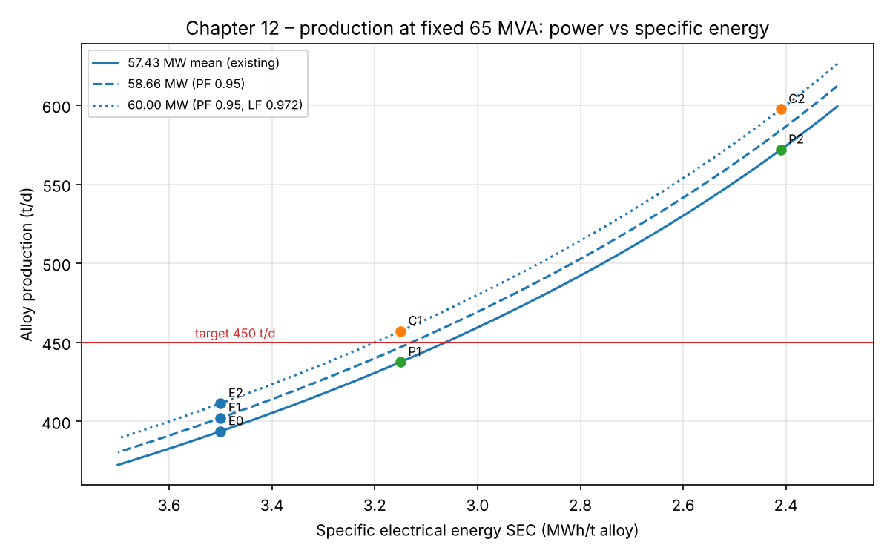

# CHAPTER 12 – DEVELOPMENT OF ALTERNATIVES

*Author: T. Motsemme · Revision B (academic draft; screening stage) · Checked by: Simphiwe – pending*

## 12.1 Introduction

This chapter generates, screens and evaluates alternative means of meeting the performance requirements set out in Chapter 4. A structured approach is followed. First, the governing relationship between power, specific energy and production is used to identify the available design levers (Section 12.2). Alternatives are then generated systematically from these levers (Section 12.3) and screened technically (Section 12.4). Mandatory requirements are applied as pass/fail gates (Section 12.5), and the surviving alternatives are compared using a weighted multi-criteria matrix, whose robustness is tested by sensitivity analysis (Section 12.6). The trade-offs are discussed in Section 12.7, and a preliminary selection is made in Section 12.8. The selection is described as preliminary because it awaits the energy balance (Chapter 9), the electrical and detailed calculations (Chapters 10 and 13) and the economic evaluation (Chapter 15).

## 12.2 Design Levers

Combining Equations (4.2) and (4.4) gives the production at a fixed transformer rating:

*M* = *S* · PF · LF · 24 / SEC  (12.1)

With *S* fixed at 65 MVA, Equation (12.1) exposes three independent levers:
* the **power factor** PF, which is governed by the ratio of furnace resistance to circuit reactance and hence by electrode geometry and the short network;
* the **load factor** LF, which is governed by the time the furnace is on load;
* the **specific energy** SEC, which is governed by the thermal and chemical state of the charge.

Chapter 7 showed that at SEC = 3.5 MWh/t the production target requires 65.6 MW mean, which exceeds the on-load maximum. **No combination of the electrical levers alone can therefore meet the production target**, and at least one alternative must act on SEC.

## 12.3 Generation of Alternatives

Alternatives were generated from each lever individually and in combination (Table 12.1).

**Table 12.1:** Alternatives generated

| Code | Alternative | Mechanism | Basis |
|---|---|---|---|
| E0 | Existing operation (reference) | – | Plant data |
| E1 | Raise PF from 0.93 to 0.95 | Increase R/X from 2.53 to 3.04 (+20 %) by increasing the pitch circle diameter and adjusting electrode tip position, and/or by reducing short-network reactance | Supervisor's PF limit |
| E2 | E1 plus a load factor of 0.972 | Reduce power interruptions (electrode slipping and breakage, tapping, trips) | Required for 60 MW mean |
| P1 | Hot charging of sintered pellets at ≈ 500 °C | Sensible heat supplied outside the furnace reduces SEC by ≈ 70 kWh/t per 100 °C (Metso, n.d.)†, giving ≈ 3.15 MWh/t | Assumption A-24 |
| P2 | Hot charging of pre-reduced pellets (40–50 % metallisation, Fe + Cr) | Part of the reduction work is moved upstream; SEC target 2.41 MWh/t | Plant data target |
| C1 | E2 + P1 | Electrical uprate and hot charging | Combination |
| C2 | E2 + P2 | Electrical uprate and pre-reduction | Combination |

Three further options were rejected before screening:
1. **A power factor above 0.95**, because it lies outside the range accepted by the supervisor.
2. **Replacement of the transformers with a higher rating**, because the 65 MVA rating is a constraint of the brief.
3. **Shunt capacitor compensation on the HV side.** It improves the power factor seen by the grid, but it does not reduce the apparent power drawn through the furnace transformers, and therefore cannot increase the active power available to the furnace.

## 12.4 Technical Screening

Equation (12.1) was evaluated for each alternative (Table 12.2, Figure 12.1). For example, for C1: *M* = 60.00 × 24 / 3.15 = 457.1 t/d.

**Table 12.2:** Technical screening of alternatives

| Code | Mean power (MW) | SEC (MWh/t) | Production (t/d) | Change from E0 | DC-14 (≥ 450 t/d) |
|---|---|---|---|---|---|
| E0 | 57.43 | 3.50 | 393.8 | – | Fail |
| E1 | 58.66 | 3.50 | 402.3 | +2.2 % | Fail |
| E2 | 60.00 | 3.50 | 411.4 | +4.5 % | Fail |
| P1 | 57.43 | 3.15 | 437.5 | +11.1 % | Fail |
| P2 | 57.43 | 2.41 | 571.9 | +45.2 % | Pass |
| C1 | 60.00 | 3.15 | 457.1 | +16.1 % | Pass |
| C2 | 60.00 | 2.41 | 597.5 | +51.7 % | Pass (upper bound) |

**Figure 12.1:** Alloy production as a function of specific energy at three mean power levels, with the 450 t/d target. The specific-energy axis is reversed, so improvements run from left to right.

Figure 12.1 shows the relative strength of the levers. The full electrical uprate (E0 → E2) increases production by only 4.5 %, whereas a 10 % reduction in specific energy (E0 → P1) increases it by 11.1 %. The production target is crossed only when the specific energy falls below about 3.2 MWh/t at 60 MW.

## 12.5 Application of Mandatory Gates

The mandatory criteria of Chapter 4 (Table 4.10) are applied before any weighting. This follows the principle that a deficiency in a mandatory requirement cannot be compensated by strength elsewhere:
* **DC-14 (production ≥ 450 t/d)** eliminates E1, E2 and P1.
* **DC-02 (PF ≤ 0.95)** is satisfied by all remaining alternatives.
* **DC-15 (alloy quality)** cannot yet be confirmed for any alternative. It is carried forward as a condition to be verified in Chapters 11 and 13.

C2 is retained only as an upper-bound variant of P2, since its throughput (+52 %) would very probably exceed the capacity of the existing off-gas, tapping and slag-handling systems. The weighted comparison is therefore made principally between **C1** and **P2**, with E2 and P1 included for reference.

## 12.6 Weighted Multi-Criteria Evaluation

The alternatives were scored from 1 (poor) to 5 (good) against six criteria, with weights reflecting the project priorities (Table 12.3). The scores are **preliminary judgements** based on the screening results and qualitative assessment. They will be revised when the capital costs (Chapter 15) and detailed technical results (Chapters 9, 10 and 13) become available.

**Table 12.3:** Weighted decision matrix (preliminary)

| Criterion | Weight (%) | E2 | P1 | P2 | C1 |
|---|---|---|---|---|---|
| Production capability against 450 t/d | 25 | 2 | 3 | 5 | 4 |
| Compliance with 60 MW brief | 15 | 5 | 1 | 1 | 5 |
| Capital cost (lower is better) | 20 | 4 | 3 | 1 | 3 |
| Technical risk (lower is better) | 15 | 3 | 3 | 2 | 3 |
| Impact on existing infrastructure | 15 | 4 | 3 | 1 | 3 |
| Technology maturity | 10 | 5 | 4 | 3 | 4 |
| **Weighted score (out of 5)** | 100 | 3.60* | 2.80* | **2.35** | **3.65** |
| Sensitivity: capital-cost weight 35 % | 100 | 3.69* | 2.94* | 2.03 | 3.43 |
| Sensitivity: equal weights | 100 | 3.83* | 2.83* | 2.17 | 3.67 |

\*E2 and P1 fail the mandatory gate DC-14 (Section 12.5) and are shown for reference only.

Among the alternatives that pass the gates, **C1 ranks first under every weighting tested**, with a margin over P2 of 1.3 to 1.5 points. The ranking is therefore robust to reasonable changes in the weights.

## 12.7 Discussion of Trade-offs

The evaluation reveals four trade-offs that should be stated explicitly.

**First, cost against requirement.** On the weighted score alone, the purely electrical uprate E2 is practically level with C1 (3.60 against 3.65). E2 would rank first if capital cost were weighted more heavily, because it requires the least new equipment. Its rejection rests entirely on the mandatory production target. If the 450 t/d target were relaxed, E2 would be the most economical way of satisfying the 60 MW brief. This demonstrates that the choice between the alternatives is driven by the production requirement rather than by the electrical uprate.

**Second, power factor against hearth temperature.** E1, and hence C1, raises the power factor by increasing the resistance-to-reactance ratio by about 20 %. If this is achieved mainly by raising the electrode tips, heat is shifted upward in the furnace. With a slag superheat of only about 44 °C (Chapter 7), this carries a risk of slag freezing. The preferred means is therefore to reduce short-network reactance and to enlarge the pitch circle diameter within proven geometric limits, rather than to raise the electrode tips. This must be confirmed in Chapters 10 and 13.

**Third, magnitude of benefit against disruption.** Pre-reduction (P2) offers by far the largest production increase (+45 %), but requires a large new upstream plant. Its throughput would place the greatest demand on the existing off-gas, tapping and slag-handling systems, which conflicts with the brownfield principle of retaining existing infrastructure. Hot charging (P1, within C1) achieves a smaller benefit with a much smaller intervention.

**Fourth, certainty of data.** The benefit of C1 depends on two assumptions of low to moderate confidence:
* the SEC reduction from hot charging (A-24), which rests on a vendor figure;
* the achievability of a load factor of 0.972.

At 60 MW, C1 meets the target only if SEC ≤ 3.20 MWh/t. The margin against the assumed 3.15 MWh/t is therefore small (1.6 %), and the alternative is sensitive to these assumptions (Chapter 16).

## 12.8 Preliminary Selection

On the basis of the screening, gating and weighted evaluation, **alternative C1 is selected provisionally**. C1 combines an electrical uprate to 60 MW mean power (PF 0.95, LF 0.972) on the existing 65 MVA transformers with hot charging of the sintered pellets at about 500 °C. It is the smallest modification that satisfies both performance requirements, with an estimated production of 457 t/d. It uses established technology, retains the furnace and its transformers, and limits the additional duty on the auxiliaries to about 16 %. Pre-reduction (P2) is retained as a longer-term option, potentially relevant to the higher target of 480 t/d, subject to the economic evaluation.

## 12.9 Limitations and Further Work

The following items must be resolved before the selection is confirmed (Table 12.4). They also identify the aspects of the design that should be revisited as better data become available.

**Table 12.4:** Items to be resolved before final selection

| Item | Responsible | Chapter |
|---|---|---|
| SEC achievable by hot charging, including the effect of preheat temperature | Ngesi | 9 |
| Electrode-geometry and short-network changes giving R/X +20 % without reducing hearth temperature | Jeff | 10, 13 |
| Realistic improvement in load factor to 0.972 | Jeff, Ngesi | 10, 19 |
| Capital and operating costs and NPV of C1 and P2 | Sibandze | 15 |
| Capacity of off-gas, cooling and tapping systems at +16 % throughput | Jeff, Sibandze | 13, 14 |
| Sensitivity of the selection to PF, LF, SEC and Cr recovery | Simphiwe | 16 |

## 12.10 Summary

Equation (12.1) shows that, at a fixed transformer rating, production depends on the power factor, the load factor and the specific energy. Seven alternatives were generated from these levers and screened technically. The production target of 450 t/d proved unattainable by electrical measures alone, eliminating the purely electrical options. After gating and weighted evaluation, the combination of a 60 MW electrical uprate with hot charging of the pellets (C1) was selected provisionally, and it ranked first under all weightings tested. The selection remains conditional on the energy-balance, electrical and economic analyses of the following chapters.

## References

Ferrochrome Data Workbook (2026) *Ferrochrome smelting – data workbook: consolidated plant inputs, charge recipe, raw materials, metal, slag and process assumptions*. Unpublished plant data set supplied by the project supervisor.

Metso (n.d.) *SAF smelting plant*. Available at: https://www.metso.com/portfolio/saf-smelting-plant/ (Accessed: 18 November 2026).†

Mulholland, A.C. (2009) 'The effectiveness of current control of submerged arc furnace electrode penetration in selected scenarios', *Journal of the Southern African Institute of Mining and Metallurgy*, 109(10).†

† Consulted at abstract level; to be verified against the full text before submission (reference register, document 05).
