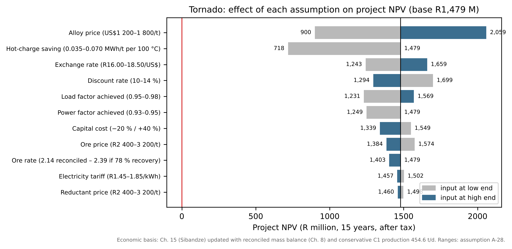
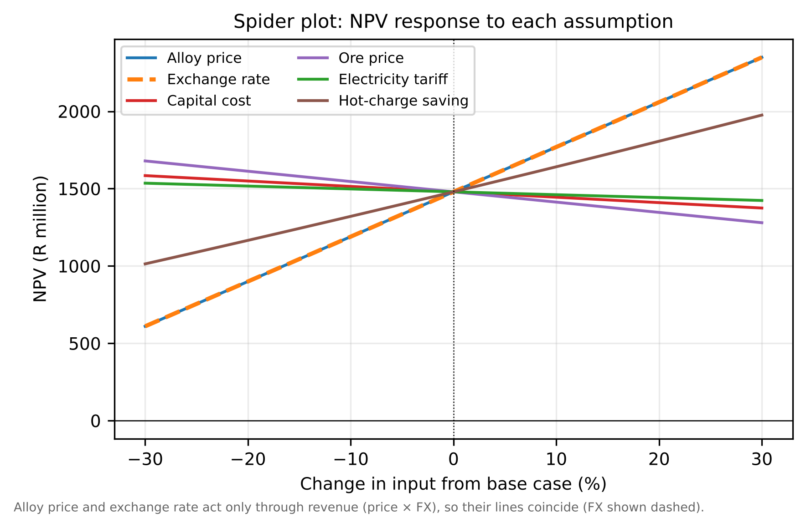
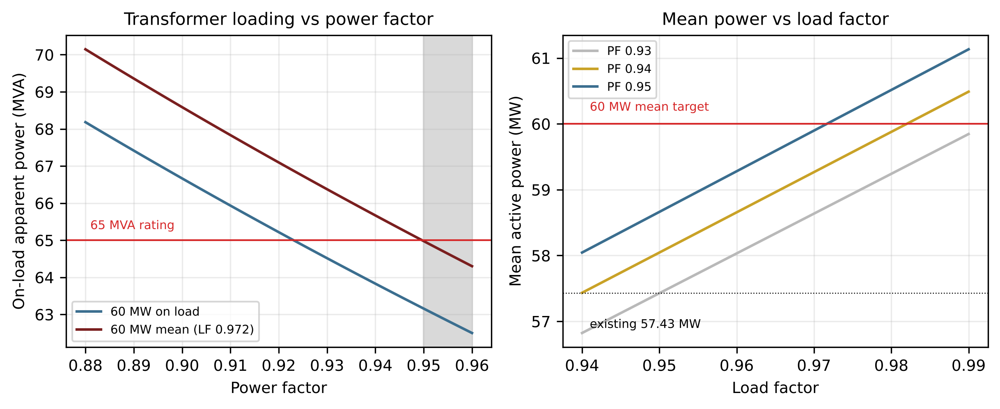
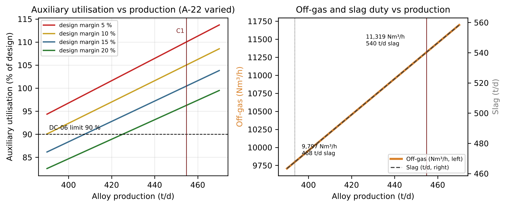

# CHAPTER 16 – SENSITIVITY ANALYSIS

*Author: Simphiwe · Revision B (upgraded with model results) · Model: safmodel (Python), cross-validated in MATLAB/Octave*

## 16.1 Purpose

This chapter determines how changes in the key design and economic assumptions affect the technical feasibility and the economic performance of the selected design, C1. C1 is the 60 MW mean electrical uprate on the existing 65 MVA transformers, combined with hot charging of the pellets. The chapter answers three questions:
1. Which assumptions have the largest effect on the **project NPV**?
2. How do the **electrical system** (transformer loading, mean power) and the **auxiliary systems** (cooling, off-gas, feed, tapping, slag) respond?
3. Under which conditions does the recommendation change?

## 16.2 Methodology

A **one-variable-at-a-time (OAT)** approach was used:

1. The 60 MW mean operating condition (C1) was established as the reference case.
2. The base values were taken from the common assumptions register and the data workbook.
3. A lower and an upper limit were defined for each parameter (Table 16.1; assumption A-28).
4. Each parameter was varied between its limits while all others were held at their reference values. The electrical, production and economic outputs were recalculated.
5. The results were compared with the acceptance criteria of the design basis (Chapter 4).
6. The parameters were ranked by their influence on project NPV.

The results are presented as comparison tables, a **tornado chart** ranking the effect of each assumption on NPV, a spider plot, and **separate technical plots** for the electrical and auxiliary systems. The economic model reproduces the method of Chapter 15. It is updated with the reconciled mass balance of Chapter 8 (ore 2.144 t/t, reductant 0.433 t/t, flux 0.366 t/t) and the conservative C1 production (preheat measured from ambient). The base-case NPV was checked independently in MATLAB/Octave; the two agree to 2 × 10⁻¹⁵.

**Table 16.1:** Parameters investigated and their ranges

| Parameter | Base value | Range tested | Basis |
|---|---|---|---|
| Alloy price | US$1 500/t | US$1 200–1 800/t | Ch. 15 (SMM benchmark) |
| Hot-charge SEC saving | 0.070 MWh/t per 100 °C | 0.035–0.070 | Vendor rule (Metso); half to full |
| Exchange rate | R17.42/US$ | R16.00–18.50 | Ch. 15 |
| Discount rate | 12 % | 10–14 % | Ch. 15 |
| Load factor achieved | 0.972 | 0.95–0.98 | Ch. 12 (C1 requires 0.972) |
| Power factor achieved | 0.95 | 0.93–0.95 | Supervisor limit 0.95 (DC-02) |
| Capital cost | R310 M (+20 % contingency) | −20 % / +40 % | Ch. 14 estimate accuracy |
| Ore price | R2 800/t | R2 400–3 200/t | Ch. 15 |
| Ore rate | 2.144 t/t (reconciled) | 2.144–2.39 t/t | Ch. 8; 2.39 if recovery were 78 % |
| Electricity tariff | R1.65/kWh | R1.45–1.85/kWh | Ch. 15 / Eskom |
| Reductant price | R2 800/t | R2 400–3 200/t | Ch. 15 |
| Auxiliary design margin (A-22) | 10 % | 5–20 % | Technical plot only (Fig. 16.4) |

## 16.3 Base case

**Table 16.2:** Base case of the economic model

| Quantity | Updated base (reconciled, conservative) | Chapter 15 basis (reproduced) |
|---|---|---|
| C1 production | 454.8 t/d | 457.3 t/d |
| Extra alloy | 22 311 t/yr | 23 233 t/yr |
| Incremental revenue | R583.0 M/yr | R607.1 M/yr |
| Incremental operating cost | R214.5 M/yr | R222.0 M/yr |
| Incremental profit (pre-tax) | R368.5 M/yr | R385.1 M/yr |
| Total investment | R402.0 M | R402.0 M |
| After-tax cash flow | R276.2 M/yr | R288.3 M/yr |
| **NPV (15 years, 12 %)** | **R1 479 M** | R1 562 M (Ch. 15: ≈ R1 540 M) |
| IRR | 68.7 % | 71.7 % |
| Payback (after tax) | 1.46 years | 1.39 years |

The model reproduces the Chapter 15 result to within rounding, which confirms the method. The updated base is about **R80 M lower**, mainly because the conservative production estimate (454.8 t/d instead of 457.1 t/d) reduces the extra tonnes sold.

## 16.4 Economic sensitivity: tornado chart

**Figure 16.1:** Tornado chart ranking the effect of each assumption on project NPV.

**Table 16.3:** NPV at the limits of each range, ranked by swing

| Rank | Parameter | NPV at low (R M) | NPV at high (R M) | Swing (R M) |
|---|---|---|---|---|
| 1 | Alloy price | 900 | 2 059 | 1 159 |
| 2 | Hot-charge saving | 718 | 1 479 | 761 |
| 3 | Exchange rate | 1 243 | 1 659 | 416 |
| 4 | Discount rate | 1 699 | 1 295 | 404 |
| 5 | Load factor achieved | 1 231 | 1 569 | 338 |
| 6 | Power factor achieved | 1 249 | 1 479 | 231 |
| 7 | Capital cost | 1 549 | 1 339 | 210 |
| 8 | Ore price | 1 574 | 1 384 | 190 |
| 9 | Ore rate | 1 479 | 1 403 | 77 |
| 10 | Electricity tariff | 1 502 | 1 457 | 45 |
| 11 | Reductant price | 1 499 | 1 460 | 39 |

**Figure 16.2:** Spider plot of NPV against the percentage change in each input.

**Interpretation.**
* **The market dominates the economics.** The alloy price, and with it the exchange rate, has the largest effect. However, the NPV remains positive across the whole range tested. NPV falls to zero only at an alloy price of **US$734/t**, which is about half the current benchmark.
* **The hot-charging saving is the largest technical uncertainty.** If only half the vendor saving is achieved, the NPV falls by R761 M. More importantly, production drops to 432 t/d and the 450 t/d criterion is failed.
* **The project is not sensitive to capital cost or electricity price.** The capital cost would have to rise to about **R1 620 M** (five times the estimate) before the NPV became zero. A change of ±R0.20/kWh in the tariff moves the NPV by less than R25 M.
* **Operating discipline has real value.** The load factor (uptime) and the power factor achieved together swing the NPV by more than R550 M, which justifies the electrode-reliability and short-network work.

## 16.5 Electrical-system sensitivity

**Figure 16.3:** Electrical sensitivity: (left) on-load transformer loading against power factor; (right) mean active power against load factor.

The apparent power drawn through the transformers is *S* = *P* / PF. Table 16.4 extends the original analysis to show both meanings of "60 MW".

**Table 16.4:** Transformer loading against power factor

| Power factor | *S* for 60 MW **on load** (MVA) | Loading | *S* for 60 MW **mean** at LF 0.972 (MVA) | Loading |
|---|---|---|---|---|
| 0.880 | 68.18 | 104.9 % | 70.15 | 107.9 % |
| 0.900 | 66.67 | 102.6 % | 68.59 | 105.5 % |
| 0.920 | 65.22 | 100.3 % | 67.10 | 103.2 % |
| 0.923 | 65.00 | 100.0 % | 66.88 | 102.9 % |
| 0.930 | 64.52 | 99.3 % | 66.37 | 102.1 % |
| 0.950 | 63.16 | 97.2 % | 64.98 | 100.0 % |

**Interpretation.**
* For 60 MW **mean** power, the transformers reach their 65 MVA rating on load at exactly PF = 0.95. There is **no headroom** if the power factor falls below 0.95.
* The right-hand plot shows that, at the supervisor's PF limit of 0.95, a load factor of 0.972 is required. At PF 0.93 even a load factor of 0.99 does not reach 60 MW mean.
* The electrical uprate is therefore governed by two operating parameters that must both be at their limits: **PF = 0.95 and LF ≥ 0.972**.

## 16.6 Auxiliary-system sensitivity

**Figure 16.4:** Auxiliary-system sensitivity: (left) utilisation against production for design margins of 5–20 %; (right) off-gas and slag duty against production.

Per tonne of alloy the consumption and generation rates are fixed by the chemistry (Ch. 8). Every auxiliary duty therefore rises in proportion to production, by **+15.5 %** at C1:
* **Off-gas:** 9 797 → 11 319 Nm³/h.
* **Slag:** 468 → 540 t/d.
* **Ore:** 844 → 975 t/d.

Whether the auxiliaries are adequate depends on their design margin (assumption A-22), which is unknown:

**Table 16.5:** Auxiliary utilisation at C1 production

| Design margin over existing duty | Utilisation at C1 | Criterion DC-06 (≤ 90 %) |
|---|---|---|
| 5 % | 110 % | Fails – upgrade required |
| 10 % (assumed) | 105 % | Fails – upgrade required |
| 15 % | 100 % | Fails |
| 20 % | 96 % | Fails |
| ≥ 28 % | ≤ 90 % | Passes |

**Interpretation:** unless the existing cooling-water, off-gas, slag and ore-handling systems were designed with **at least 28 % spare capacity**, they must be upgraded for C1. This confirms the R30 M auxiliary allowance in Chapter 14 as **essential**. Measuring the actual auxiliary capacities is a priority, because the margin cannot be inferred from the available data.

## 16.7 Combined comparison of key cases

**Table 16.6:** Technical and economic comparison of key sensitivity cases

| Case | Mean power (MW) | SEC (MWh/t) | Production (t/d) | ≥ 450 t/d | Aux. utilisation (10 % margin) | NPV (R M) | IRR | Payback (y) |
|---|---|---|---|---|---|---|---|---|
| Base case C1 | 60.02 | 3.167 | 454.8 | Yes | 105 % | 1 479 | 68.7 % | 1.46 |
| Hot-charge saving halved | 60.02 | 3.334 | 432.1 | **No** | 100 % | 718 | 40.7 % | 2.44 |
| Load factor stays 0.95 | 58.66 | 3.167 | 444.5 | **No** | 103 % | 1 231 | 59.6 % | 1.68 |
| Power factor stays 0.93 | 58.76 | 3.167 | 445.2 | **No** | 103 % | 1 249 | 60.2 % | 1.66 |
| Alloy price US$1 200/t | 60.02 | 3.167 | 454.8 | Yes | 105 % | 900 | 47.4 % | 2.10 |
| Capital cost +40 % | 60.02 | 3.167 | 454.8 | Yes | 105 % | 1 339 | 50.3 % | 1.98 |
| Ore rate 2.39 t/t (78 % recovery) | 60.02 | 3.167 | 454.8 | Yes | 105 % | 1 403 | 65.9 % | 1.52 |

## 16.8 Conclusions

1. **The project is economically robust.** NPV is positive in every case tested, and break-even requires an alloy price below US$734/t or a fivefold capital overrun.
2. **The project is technically fragile against the production target.** Three single deviations each cause the 450 t/d criterion to fail:
   * the hot-charging saving being only half the vendor value;
   * the load factor staying at 0.95;
   * the power factor staying at 0.93.

   The 450 t/d target, not the economics, is the binding requirement.
3. **The power factor must be held at 0.95.** Below this, the transformers would be overloaded at 60 MW mean.
4. **Auxiliary upgrades are required** unless the existing systems have at least 28 % spare capacity.
5. **Recommended actions:**
   * a plant trial to measure the actual hot-charging saving before capital release;
   * power-quality metering to confirm the achievable power factor;
   * an availability (load factor) improvement plan;
   * a survey of the actual auxiliary-system capacities.

## References

Ferrochrome Data Workbook (2026) *Ferrochrome smelting – data workbook*. Unpublished plant data set supplied by the project supervisor.

Metso (n.d.) *SAF smelting plant*. Available at: https://www.metso.com/portfolio/saf-smelting-plant/ (Accessed: 18 November 2026).

SMM (2026) 'Samchrome cuts Q4 European ferrochrome benchmark by 4 cents to 152 US cents/lb', *Shanghai Metals Market*, 27 October 2026.
